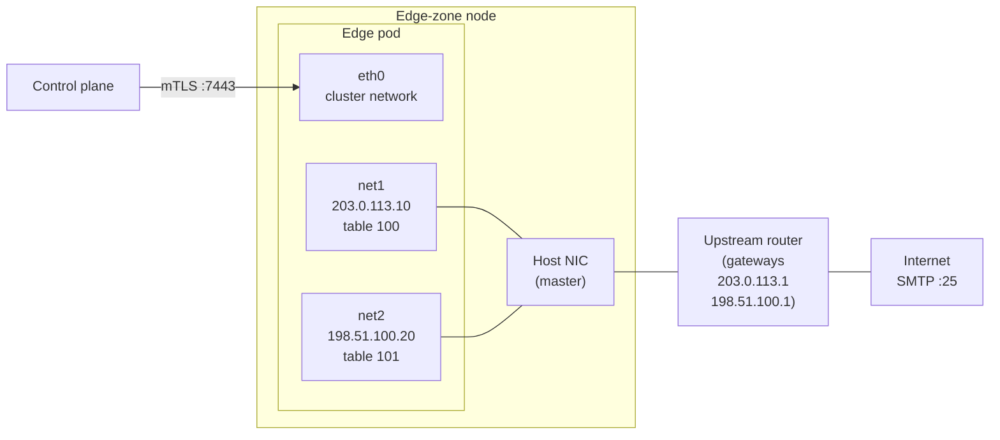

# Direct public networking

An advanced topic. The edge worker must send and receive SMTP on public IPv4 addresses that you control, and mail servers judge you by those addresses: reverse DNS, SPF and reputation all attach to them. Instead of putting the pod behind cluster NAT, the chart gives the edge pod a **second network interface** that carries the public address directly. The cluster's own network, which carries the control connection, is untouched.

Read this page if you set up the edge zone, add a sending address, change CNI plugins or debug a failover. You need it once per environment; after that you rarely touch it.

## How it fits together



Each sending address is one attachment:

| Piece | What it does |
| --- | --- |
| **Multus** | Lets a pod attach extra interfaces from `NetworkAttachmentDefinition` objects, listed in the pod annotation `k8s.v1.cni.cncf.io/networks`. |
| **`ipvlan` in `l2` mode** | Creates the interface on the host NIC named by `master`. Every ipvlan interface on a node shares that NIC's MAC address. |
| **Whereabouts** | Allocates the address. The chart sets `range_start` and `range_end` to the same address, so each pool holds exactly one address, and a second pod can never take it. |
| **`sbr`** | Adds source-based routing: a rule that sends traffic from that address through a dedicated routing table. |

The first address is attachment `thinpost-public` on `net1`, using routing table `publicNetwork.table` (default 100). Each entry of `additionalSources` is `thinpost-public-N` on `net{N+1}`, using table `publicNetwork.table + N`. Because each attachment has its own gateway and table, addresses in different networks leave through their own gateways, and the pod's default route stays on the cluster interface.

## What the chart renders

For the primary address `203.0.113.10` and one additional address, the chart renders these attachments (trimmed to the essentials):

```json
{
  "cniVersion": "1.1.0",
  "name": "thinpost-public",
  "plugins": [
    {
      "type": "ipvlan",
      "master": "eth1",
      "mode": "l2",
      "mtu": 1500,
      "ipam": {
        "type": "whereabouts",
        "range": "203.0.113.0/24",
        "range_start": "203.0.113.10",
        "range_end": "203.0.113.10",
        "gateway": "203.0.113.1",
        "routes": [
          {"dst": "203.0.113.1/32", "gw": "0.0.0.0", "table": 100, "scope": 253},
          {"dst": "0.0.0.0/0", "gw": "203.0.113.1", "table": 100}
        ]
      }
    },
    {"type": "sbr", "table": 100}
  ]
}
```

The second attachment, `thinpost-public-1`, is the same with its own `master`, range, address, gateway and `table: 101`. The pod annotation lists them in order:

```text
k8s.v1.cni.cncf.io/networks: [{"name":"thinpost-public","interface":"net1"},{"name":"thinpost-public-1","interface":"net2"}]
```

The values that drive this:

```yaml
sourceAddress: 203.0.113.10
publicNetwork:
  master: eth1
  range: 203.0.113.0/24
  gateway: 203.0.113.1
  mtu: 1500
  table: 100
additionalSources:
  - address: 198.51.100.20
    hostname: smtp2.example.com
    range: 198.51.100.0/24
    gateway: 198.51.100.1
    master: eth2
```

## Prerequisites

- **Multus** installed in the cluster.
- **CNI plugins** `ipvlan` and `sbr`, and the **Whereabouts** IPAM plugin, installed on every node that may run the edge.
- Plugin versions that understand CNI configuration version **1.1.0**, including route entries with `table` and `scope`. An older `ipvlan` binary supports configuration only up to 1.0.
- The `master` interface exists with the **same name on every node** that may host the edge, and is connected to the network that carries your public addresses.
- If the nodes are virtual machines, the virtual NIC must permit traffic from every sending address and from several addresses behind one MAC. Disable per-NIC IP or anti-spoofing filters that would drop them.
- The edge pod needs no privilege and no host networking. It sets only the safe sysctl `net.ipv4.ip_unprivileged_port_start=0`, which your Pod Security policy must allow.

### Plugins installed under other names

Some clusters install the CNI binaries under versioned or custom names, and the plugin name in the attachment must match the binary. Override them for every attachment at once:

```yaml
publicNetwork:
  cniTypes:
    ipvlan: ipvlan-custom
    sbr: sbr-custom
```

The defaults are `ipvlan` and `sbr`. If a policy engine in your cluster needs a label on attachments, `attachmentLabels` adds labels to every `NetworkAttachmentDefinition`, the primary and each additional one:

```yaml
publicNetwork:
  attachmentLabels:
    example.com/approved: "true"
```

Whereabouts is referenced by its standard name and is not configurable here.

## Router requirements

The edge zone's upstream router, or its firewall, is the only filter for public traffic: the chart's NetworkPolicy covers only the cluster interface. Configure it as follows.

| Requirement | Detail |
| --- | --- |
| **Inbound TCP/25** | Allow it to **every** sending address, not only the primary. Every address listens for SMTP, because bounces and inbound mail may arrive on any of them. |
| **Inbound TCP/465 and TCP/587** | Only with SMTP submission enabled (`smtpSubmission.enabled`): allow both to **every** sending address. They carry authenticated client mail with TLS, and each address presents its own certificate on them. Clients inside the cluster should use the [internal listener](/deploy/helm-edge#smtp-submission) instead, because the public path arrives through SNAT and shares one source address. |
| **Outbound TCP/25 only** | Allow the edge addresses to open outbound connections on TCP/25 and nothing else. The edge needs no other egress on these addresses. The edge applies no destination policy of its own (the control plane filters every route), so this rule, restricted to public destinations, is the boundary against a compromised control plane. |
| **Gateway and ARP** | The gateway for each attachment must be on that attachment's network and must answer ARP for the address. A new network needs its own gateway. |
| **Routes** | The addresses must be routed to the edge zone's interface. |
| **Reverse DNS** | Set the PTR for every address to its hostname at the address owner. |

### An optional source guard

An optional hardening step is an **interface-based source guard** on the router: accept packets whose source is a Thinpost sending address only when they arrive on the interface that faces the edge zone, and drop them anywhere else. This stops another device, or a spoofed packet from another port, from using your address. It checks the **interface**, not the sender's MAC.

### Why a per-node MAC filter is a bad fit

Some routers can bind an address to a list of permitted MAC addresses. Do not use that here. `ipvlan` in `l2` mode gives every address on a node the node NIC's MAC, so a MAC list can only name nodes, never pods or addresses. When the edge moves to another node, its address now appears behind a different MAC, and a router with a MAC guard silently drops the outbound mail. Worse, ARP from the moved pod still completes and the pod becomes Ready, so nothing looks wrong until delivery fails. The interface-based guard works because the interface does not change when the pod moves.

If your router can only guard by MAC, keep `node` set in the values so the edge stays on a listed node, and accept that failover is manual. See [Pinning to a node](/deploy/helm-edge#pinning-to-a-node).

## Floating across nodes

The edge is built to float between nodes. It attaches through Multus and Whereabouts, so the pod may start on any node that can host the attachments. Only one pod can hold the journal volume (`ReadWriteOnce`) and the single-address pools refuse a second holder, so the Deployment runs one replica with `Recreate` and the old and new pods never send at the same time. There is no PodDisruptionBudget, and no affinity or topology constraint.

### ARP refresh and readiness

A router learns "address is at this MAC" through ARP. After a move, the router's entry for the address is stale until it asks again. The worker therefore announces itself:

1. For each source address (the primary first, then each additional source), it opens an ordinary UDP socket **bound to that source** and sends one byte to **that source's gateway, port 9** (discard).
2. To send, the kernel ARPs for the gateway from that source address. That request carries the address and the node's MAC and refreshes the router's entry. It needs no capability, raw socket or host networking, so the pod stays within the restricted Pod Security profile.
3. The worker polls `/proc/net/arp` until each gateway has a complete entry on the interface that holds the source, resending every 500 ms.

The gateways come from the chart in `THINPOST_EDGE_SOURCE_GATEWAYS`: a comma-separated list, primary first, with each source's own gateway. The count must match the number of sources. An empty value disables the announcement and its readiness gate.

This gates readiness:

- **Ready** once every gateway has a complete neighbour entry. The container logs one fixed line, `source neighbours ready n=N`, never an address.
- If 10 seconds pass first, the pod stays **not ready**, logs `source neighbours pending n=P of N` once and retries every 5 seconds. It is not restarted.
- Once ready, the worker repeats the announcement every 30 seconds.
- **Liveness and startup probes check only the journal**, so an unresolved neighbour delays readiness but never restarts the worker.

The datagram to port 9 may be dropped by the router. Only the ARP exchange matters. A source's own gateway must be reachable on the same network.

::: warning Readiness proves less than it seems
A ready edge proves the router learned the new MAC. It does not prove the router admits the traffic. After the first move in an environment, confirm outbound delivery from **every** address, and check the greeting and certificate of each from outside the cluster.
:::

### Graceful moves

Drains, rollouts and evictions need nothing manual. `Recreate` stops the old pod first on a rollout. On a drain or eviction the replacement may be created at once, but it cannot start until the old pod has released the journal volume, and the Whereabouts pools refuse a second holder. The new pod then announces itself. Verify with the delivery banner and outbound checks per address.

### Hard node failure

If a node dies without draining, the old pod stays `Terminating` and holds the journal volume and the Whereabouts allocations. The chart cannot fence a dead node. Do this by hand, in order:

1. Confirm the old node is powered off or isolated. **Never continue while it might still send from the addresses or write the journal.**
2. Taint the node so Kubernetes can detach the volume and delete the pod's resources:

   ```sh
   kubectl taint node <node> node.kubernetes.io/out-of-service=nodeshutdown:NoExecute
   ```

3. Only after step 1, force-delete the stuck pod if it remains:

   ```sh
   kubectl -n thinpost-edge delete pod <pod> --force --grace-period=0
   ```

4. Remove the Whereabouts allocations that the pod held for each source, if they were not released, using your Whereabouts version's documented procedure. Then let the Deployment schedule the replacement and watch for `source neighbours ready`.
5. Remove the taint after the node is repaired and rejoined.

## Verify the routing

The repository includes a disposable local lab that checks, with synthetic addresses, that two attachments route out of their own interfaces and that the original default route survives: [`scripts/verify-edge-routing.py`](https://github.com/zyno-io/thinpost/blob/main/scripts/verify-edge-routing.py). It needs Docker with privileges to create network namespaces. It uses static addressing, so it does not exercise Whereabouts, your router or real SMTP.

In your cluster, look for the readiness line after an install and after each move:

```sh
kubectl -n thinpost-edge logs deploy/thinpost-edge-worker | grep 'source neighbours'
```

`source neighbours ready n=N` with N equal to the number of sending addresses means every gateway resolved. The edge image has no shell, so inspect the pod's network from a separate debug container if you need more. Then, from a host outside the cluster, connect to port 25 on each address and check the banner and the STARTTLS certificate.

## Next

- [Helm: Edge](/deploy/helm-edge)
- [Sending IPs](/guide/sending-ips)
- [Architecture](/guide/architecture)
