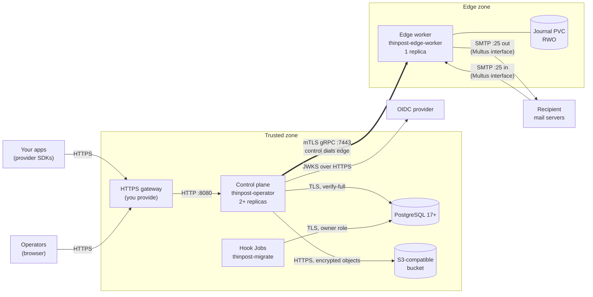

# Deployment overview

A Thinpost deployment is two Helm releases of one chart plus the services they depend on. The **control plane** runs in a trusted zone next to PostgreSQL and your object store. The **edge worker** runs in an edge zone with public IPv4 addresses and speaks SMTP to the internet.

This section covers the Kubernetes deployment. To try Thinpost on a laptop first, use the [Quickstart](/guide/quickstart).

## What runs where

| Component | Kubernetes object | Zone | Holds |
| --- | --- | --- | --- |
| Control plane | Deployment `thinpost-operator` (2 or more replicas) | Trusted | Every secret: database credentials, the object keyring (which also seals the DKIM keys held in the database), fingerprint keys, the control client certificate |
| Migration and gate hooks | Helm hook Jobs, ServiceAccount `thinpost-migrate` | Trusted | The schema owner credential, mounted only in the Jobs |
| Edge worker | Deployment `thinpost-edge-worker` (0 or 1 replica) | Edge | The journal, its control certificate, its public SMTP certificates. No database or object-storage credentials |
| PostgreSQL | Yours | Trusted | Application state, queues, the admission gate |
| Object store | Yours | Trusted | Encrypted message objects |

The control plane dials the edge. The edge never opens a connection into the trusted zone. See [Architecture](/guide/architecture) for the protocol.

The two releases can sit in different namespaces of one cluster or in different clusters. The control plane needs to reach only the edge's control port, and the edge needs to reach nothing in the trusted zone.

## What you provide

| Requirement | Notes |
| --- | --- |
| Kubernetes and Helm 3 | The chart renders Deployments, Jobs, a NetworkPolicy and NetworkAttachmentDefinitions. It creates no Services, Secrets or ConfigMaps. See [Helm: control](/deploy/helm-control) and [Helm: Edge](/deploy/helm-edge). |
| PostgreSQL 17 or newer | Reachable over TLS with a certificate you can verify. The privilege audits use the `MAINTAIN` table privilege, which PostgreSQL added in 17. See [Database](/deploy/database). |
| S3-compatible object store | A private bucket with TLS, conditional create (`If-None-Match: *`) and strongly consistent `HEAD`. See [Object storage](/deploy/object-storage). |
| Certificate issuance | A private CA for the control channel, a public certificate for each SMTP host name, and a certificate for any HTTPS listener you terminate yourself. cert-manager works well, and the examples use it. See [Control PKI](/deploy/control-pki). |
| A public IPv4 address with reverse DNS | One address for the edge's primary SMTP identity. Its PTR record, its A record and the edge's HELO name must agree. More addresses are optional. See [Sending IPs](/guide/sending-ips). |
| Multus, the `ipvlan` and `sbr` CNI plugins, and Whereabouts | Give the edge pod a direct public interface. See [Direct public networking](/deploy/direct-public-networking). |
| An OIDC provider | Issues JWT access tokens to your operators. See [Operator authentication](/deploy/operator-auth). |
| An HTTPS entry point | A Gateway, Ingress or load balancer that terminates TLS for your API and console host name and forwards to the `thinpost-operator` Service. The chart has none. |
| DNS you control | For the console host name, the SMTP host names (also the bounce domains) and, if you receive mail, the MX host. |

Optional:

- The [Stakater Reloader](https://github.com/stakater/Reloader) controller. The control Deployment carries a Reloader annotation by default so that a renewed control client certificate restarts the pods. Without Reloader, set `control.reloader.enabled=false` and restart the Deployment yourself after a renewal.

### Network paths to allow

| From | To | Port | Why |
| --- | --- | --- | --- |
| Control pods | PostgreSQL | TCP 5432 | Application state |
| Hook Jobs | PostgreSQL, Kubernetes API | TCP 5432, 443 | Migration, and the rollout check in the post hook |
| Control pods | Object store | TCP 443 | Message objects |
| Control pods | OIDC provider | TCP 443 | JWKS download |
| Control pods | Cluster DNS and recursive resolvers | UDP and TCP 53 | The control plane looks up recipient MX records. The edge has no DNS access. |
| Control pods | Webhook receivers | TCP 443 | Signed HTTPS callbacks to public addresses |
| Control pods | Edge control Service | TCP 7443 | The mTLS control stream |
| Your HTTPS entry point | Control pods | TCP 8080 (and 8443 if enabled) | API and console |
| Internet | Edge public addresses | TCP 25 | Bounces, feedback reports, inbound mail |
| Edge public addresses | Internet | TCP 25 | Outbound mail |

## Deploy checklist

Do these in order. Each step links to the page that holds the detail.

1. **Choose names.** Pick the console host name, the SMTP host name of each sending address (the edge's HELO, PTR and bounce domain), a worker ID and a SPIFFE trust domain. Generate a deployment generation (`openssl rand -hex 16`). The pages use `thinpost.example`, `smtp.example.com` and `203.0.113.10` as stand-ins.
2. **Create the namespaces** for the control plane and the edge, with whatever pod security level you apply. The workloads run non-root with a read-only root file system and dropped capabilities.
3. **Prepare PostgreSQL.** Create the owner and runtime roles and the database, then run `bootstrap-database`, `migrate` and `grant-runtime`, and open the admission gate once. See [Database](/deploy/database).
4. **Prepare the bucket.** Create it, grant the control credential, apply the lifecycle rule for `inbound/` and generate the object keyring. See [Object storage](/deploy/object-storage).
5. **Register the OIDC applications** and decide the `THINPOST_OIDC_*` settings. See [Operator authentication](/deploy/operator-auth).
6. **Issue the control PKI.** Create the private CA and the two control certificates, and the public SMTP certificate. See [Control PKI](/deploy/control-pki).
7. **Prepare the edge zone.** Install Multus, the CNI plugins and Whereabouts, configure the upstream router for the edge address, and set DNS and PTR. See [Direct public networking](/deploy/direct-public-networking).
8. **Create the journal volume and read its identity** with `thinpost-edge journal-id`. Record it in the edge binding. See [Helm: Edge](/deploy/helm-edge).
9. **Create every external resource** the two releases consume: Secrets, ConfigMaps, the ServiceAccount, Services and NetworkPolicies. See [Helm: control](/deploy/helm-control) and [Helm: Edge](/deploy/helm-edge).
10. **Install the edge release** with `replicas: 1`. Wait for it to become Ready.
11. **Install the control release** with at least two replicas and wait for the hooks and the rollout.
12. **Publish the HTTPS route,** sign in to the console, create a first app and send a test message. See [Operator console](/guide/console) and [Domains](/guide/domains).
13. **Plan upgrades.** Read [Upgrades](/deploy/upgrades) before the first one, and set Helm or HelmRelease timeouts to match.

::: tip Dry run first
The edge accepts only `replicas` of 0 or 1. Installing it with `replicas: 0` renders the attachments and the NetworkPolicy without starting a pod, which is a cheap way to check your values before you touch the public network.
:::

## Next

- [Database](/deploy/database)
- [Object storage](/deploy/object-storage)
- [Operator authentication](/deploy/operator-auth)
