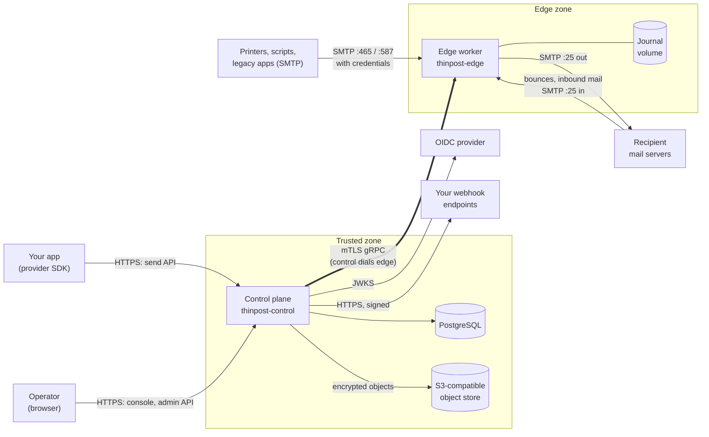
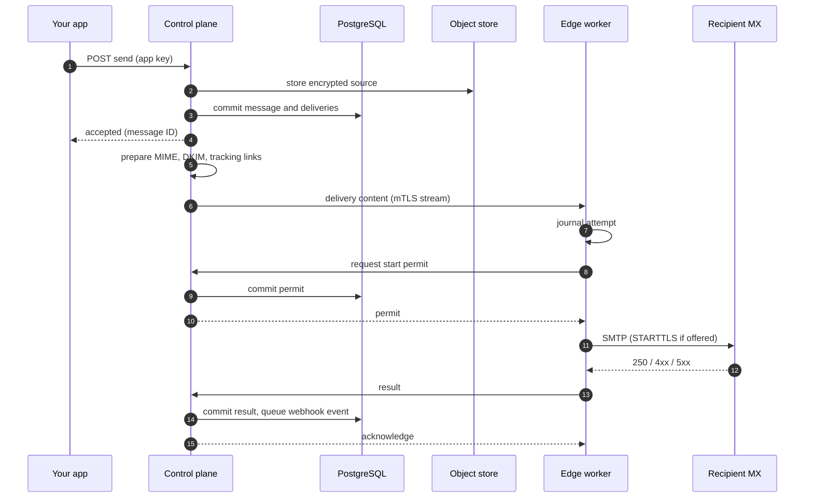

# Architecture

Thinpost is two Go processes plus the stores they use. The control plane makes every decision. The edge worker moves bytes over SMTP.

## Control plane

One binary, run as several replicas, serves:

- the provider submission routes (`/email`, `/emails`, `/v3/mail/send`, `/v3/{domain}/messages`) and the app routes under `/app/v1/` (the native send route `/app/v1/messages`, reads, and release or cancel of held messages), all through one acceptance path;
- the operator admin API under `/api/v1` and the console on the same origin;
- the tracking and unsubscribe routes under `/t/`.

In the background it prepares messages (MIME, DKIM, tracking links), claims deliveries, talks to the edge, dispatches webhooks and runs the maintenance loops.

It owns application authorization, delivery decisions, queues, database records, message storage, signing, tracking and webhooks.

## Edge worker

The edge worker sends SMTP, and receives delivery-status mail and inbound mail. It runs as non-root, and runs as a single replica with a journal volume that only one pod may hold. It has no database or object-storage credentials. It receives only the bytes of the delivery it is asked to send.

It binds each sending IP it is configured with, greets with that address's own name, and listens for SMTP on every one of them. With [SMTP submission](/guide/smtp) enabled it also listens on ports 465 and 587 of each address, for clients that send mail with a credential. The edge verifies nothing itself: it passes the credential and the message to the control plane, which checks the credential, applies the app's policy and limits and commits the message, and the client gets its final reply only after that. Like inbound mail, submission is answered with `451` when the stream to the control plane is down, and the edge keeps no spool.

## Control protocol

The control plane **dials** the edge and keeps a bidirectional gRPC stream open over mutual TLS. The edge never opens a connection into the trusted zone. A private certificate authority issues distinct identities for each side, expressed as SPIFFE-form URI names; neither side uses SPIRE or a service mesh.

The stream carries:

- **Leases and epochs.** A control replica holds a database-issued, signed lease with an epoch number. The edge verifies the signature against the authenticated peer certificate and its own persistent journal identity. Each new stream gets a fresh epoch, which fences any earlier controller: the edge cancels the former session and waits for its SMTP operations to exit before accepting the new one.
- **Work.** Delivery content is sent in bounded chunks, checked by size, offset and SHA-256.
- **Start permits.** Before it opens an SMTP connection the edge writes the attempt to its journal and asks for a permit. The control plane commits that authorization in the database first. A permit is bound to the worker, journal, session, epoch, attempt and a hash of the complete delivery descriptor.
- **Results.** The edge reports each result and keeps it in the journal until the controller acknowledges it. After a reconnect it replays unacknowledged results before any new work.
- **Bounces and inbound mail.** Mail received on port 25 is forwarded over the same stream. The edge answers `250` only after the control plane has committed the message and acknowledged it. The edge keeps no spool for them. If the stream is down it answers `451` and the sender retries.
- **SMTP submissions.** With [SMTP submission](/guide/smtp) on, the edge forwards a client's credential for checking and then the message, in bounded chunks, and relays the control plane's verdict as the SMTP reply. The control plane holds the credential digests and every policy.

The wire details are in the [control protocol reference](/reference/control-protocol). Certificates and rotation are covered in [Control PKI](/deploy/control-pki).

## Sending a message

A successful submission response means the message and its deliveries are committed in the database, not that mail has been sent. Everything after step 4 can be retried or recovered, which is why steps 8 to 10 are journalled and permitted.

If a connection drops between the permit and the acknowledgement, the outcome of that SMTP attempt is **uncertain**: the recipient may or may not have received it. Thinpost holds uncertain deliveries for an operator instead of automatically resending, to avoid duplicates.

## Storage

- **PostgreSQL** holds apps, key digests, domains, message and delivery metadata, queues, leases, webhook events and history, suppressions, audit events and the admission gate. Control requires the current schema at startup; migrations run during deployment. See [Database](/deploy/database).
- **Object storage** holds original submissions, signed per-recipient MIME, received bounces and inbound messages. Each object is encrypted by the control plane before upload and given a random name. See [Object storage](/deploy/object-storage).
- **The edge journal** is a small volume of attempt metadata (no message bodies) that lets the worker prove what it did across restarts.

## Network exposure

| Path | Direction | Protocol |
| --- | --- | --- |
| App to control plane | in | HTTPS |
| Browser to console | in | HTTPS, same origin as the API |
| Recipient mail servers to edge | in | SMTP on port 25 (bounces, feedback reports, inbound mail) |
| Clients to edge (optional) | in | SMTP on ports 465 (implicit TLS) and 587 (STARTTLS), only with submission enabled. Credentials are verified by the control plane |
| Control plane to edge | in the trusted zone, out to the edge | mTLS gRPC |
| Edge to recipient mail servers | out | SMTP on port 25 from your sending IPs |
| Control plane to webhook receivers | out | HTTPS to public addresses only |
| Control plane to PostgreSQL, object store, OIDC provider | out | TLS |

The edge needs public IPv4 addresses on an interface the cluster's own network policy does not control, so the edge zone has its own routing and firewalling. See [Direct public networking](/deploy/direct-public-networking).

## Operator console

The console is a single-page application built into the control image and served from the same origin as the admin API, with a strict Content-Security-Policy. Operators sign in with OpenID Connect (authorization code with PKCE). See [Operator console](/guide/console).

## Next

- [Quickstart](/guide/quickstart)
- [Threat model](/security/threat-model)
