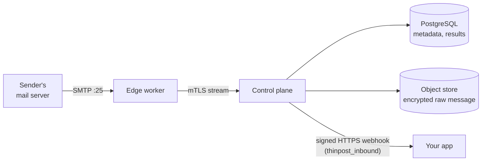

# Inbound mail

Inbound mail lets an app receive mail at its own domains, for example replies to the messages it sends. Thinpost accepts the mail on the edge, stores it encrypted, checks the sender, matches replies to your outbound messages and delivers each message to your app as a signed webhook.

An app receives mail once three things are true: it has a **verified receiving domain**, that domain's **MX record names the Thinpost mail host**, and the app has an **enabled inbound webhook endpoint**. Without an endpoint the edge answers `451` and stores nothing, so senders queue the mail and it arrives once you add one.



## Receiving domains

An administrator adds a receiving domain in the console (app, **Inbound**, **Add domain**) or with `POST /api/v1/apps/{appId}/inbound-domains`. The response carries the TXT record to publish and the `mx_host` the MX record must name.

| Record | Name | Value |
| --- | --- | --- |
| TXT | `_thinpost.mail.example.com` | `thinpost-inbound-verification=...` (shown once) |
| MX | `mail.example.com` | `10 <mx_host>.` (published **after** verification) |

1. Publish the TXT record and verify the domain.
2. Only then publish the MX record. Until the domain is verified the edge refuses mail for it with `550`, so senders get it back.

Verification looks up the TXT record through the control plane's resolver, like sender domains, with no DNSSEC validation. It shares the `_thinpost` TXT name with [sender-domain](/guide/domains) verification, and one domain can carry both challenges. Asking again for a pending domain replaces the challenge.

The mail host the MX record names is the HELO name of the sending worker's main IP, as the worker reports it (see [Sending IPs](/guide/sending-ips)). Nothing is set up in control for it. The console shows the name only when public DNS confirms it both ways: the address's reverse DNS names it, and it points at the address. Until the worker has connected, or while DNS does not confirm the name, the console shows no MX record and the MX check is unavailable, and says why.

### One owner per domain

Several apps can hold a pending claim on one domain. The first to verify owns it, and a later verification gets 409. A disabled domain keeps its owner. To move a domain, delete it from the owner and claim it again.

### Reserved names

These are refused with 400 and cannot be verified: every HELO name of the sending worker (which are also its bounce domains and the mail host) and their subdomains.

### Domain states

`pending` (unverified), `active`, and `disabled` (verified and still owned, but not received). Disabling and enabling are idempotent, and deleting frees the name.

### MX check

**Check MX** (`POST .../inbound-domains/{domain}/check-mx`) looks up the domain's MX records and stores a status. It is informational and never affects whether a domain can receive.

| Status | Meaning |
| --- | --- |
| `thinpost` | Every MX record names the Thinpost mail host |
| `mixed` | Some do and some name another host, so part of the mail goes elsewhere |
| `other` | None do |
| `none` | No MX record, or the name does not exist |
| `null_mx` | A single `.` record (RFC 7505): the domain refuses mail |
| `error` | The lookup failed and the result is unknown |

## What the edge answers

Mail for a receiving domain arrives at the same port-25 listener that handles bounces and goes to the control plane over the control stream.

| Recipient | Answer |
| --- | --- |
| A receiving domain that can receive now | `250` after the message is durably committed |
| A listed domain that cannot receive now | `451`, so the sender queues and retries |
| Anything else | `550 5.7.1` (no relaying) |

A domain **cannot receive now** when its app is paused, the domain is disabled, the app has no enabled inbound endpoint, the app's pending inbound deliveries are at their limit, the deploy gate is closed, or the edge has no live control session. Thinpost never stores mail nobody will receive and never generates a bounce, so it creates no backscatter. There is no AUTH on the port 25 listener (authenticated submission is on ports 465 and 587), and nothing in the inbound path forwards, auto-replies or sends a DSN.

The edge answers `250` only after the control plane has committed the message and acknowledged it. If an acknowledgement is lost the sender retries, and a keyed fingerprint makes the retry a duplicate rather than a second message.

### Limits

| Limit | Value |
| --- | --- |
| Message size | 10 MiB |
| Recipients per transaction | 50, all for the same app |
| Concurrent DATA transfers | 4 for inbound |
| Invalid recipients per connection | 10, then `421` |
| Transactions per connection | 20, then `421` |
| DATA time | 10 minutes |

### Per-app limits

Two limits are editable per app in the console, or with `GET`/`PUT /api/v1/apps/{appId}/inbound-limits`:

| Limit | Default | Range | Meaning |
| --- | --- | --- | --- |
| `daily_limit` | 2,000 | 1 to 1,000,000 | Messages accepted per UTC day |
| `pending_limit` | 500 | 1 to 100,000 | Inbound webhook deliveries waiting at once |

A reply to one of your own messages is exempt from the daily limit up to twice the limit, so catch-all noise cannot crowd out real replies. Over a limit the answer is `451` and the sender retries later.

## Delivery to your app

Create a webhook endpoint with format `thinpost_inbound` (**Inbound mail (Thinpost)** in the console). It represents exactly one event, `inbound_received`, has no event filter, and never receives outbound events. It uses the same signing secret, HTTP authentication, history and replay as every other endpoint, shares the ten-endpoint cap, and has a console **Send test** with a fixed synthetic message. See [Webhooks](/guide/webhooks).

One request is sent for each envelope recipient and each enabled inbound endpoint. Its event ID is stable across retries. Verify it like any native event, and deduplicate on both the event ID and `headers.message_id`.

A trimmed example payload (the `raw` field is shortened):

```json
{
  "id": "evt_inbound",
  "outcome": "inbound_received",
  "occurred_at": "2026-01-01T12:00:00Z",
  "app_id": "app-1",
  "inbound": {
    "id": "11112222333344445555666677778888",
    "received_at": "2026-01-01T12:00:00Z",
    "recipient": {
      "address": "reply+ticket-42@mail.example.com",
      "local_part": "reply+ticket-42",
      "domain": "mail.example.com",
      "tag": "ticket-42"
    },
    "envelope": {
      "mail_from": "bounces@sender.example",
      "rcpt_to": ["reply+ticket-42@mail.example.com"],
      "client_ip": "<sender IP>",
      "helo": "mail.sender.example",
      "tls": { "version": "TLS1.3", "cipher": "TLS_AES_128_GCM_SHA256" }
    },
    "headers": {
      "from": [{ "name": "Jose", "address": "jose@sender.example" }],
      "subject": "Re: Your receipt",
      "message_id": "<reply-1@sender.example>",
      "in_reply_to": "<0123456789abcdef0123456789abcdef@example.com>"
    },
    "text": "Thanks, that works.",
    "html": "<p>Thanks, that works.</p>",
    "omitted": [],
    "raw": "QXV0aGVudGljYXRpb24tUmVzdWx0czog...",
    "authentication": {
      "spf": { "result": "pass", "domain": "sender.example", "identity": "mailfrom" },
      "dkim": [{ "result": "pass", "domain": "sender.example" }],
      "dmarc": { "result": "pass", "domain": "sender.example", "policy": "reject" },
      "arc": { "present": false, "evaluated": false }
    },
    "correlation": {
      "matched": true,
      "message_id": "0123456789abcdef0123456789abcdef",
      "delivery_id": "delivery-1",
      "header": "in_reply_to",
      "from_matches_recipient": true
    },
    "classification": {
      "auto_submitted": false,
      "delivery_status_report": false,
      "feedback_report": false
    }
  }
}
```

The full field list is in [Webhook formats](/reference/webhook-formats). Points worth knowing:

- `recipient.tag` is the text after the first `+` in the local part, which suits reply addresses such as `reply+ticket-42@...`.
- `text` and `html` are the first non-attachment text and HTML parts decoded to UTF-8. A body over 1 MiB once decoded, or in a charset Thinpost cannot decode, is left out and named in `omitted`.
- There is **no attachment list**. Attachment parts are not parsed and appear only inside `raw`. There is no spam score.
- `raw` is base64 of the stored message exactly as received, with an `Authentication-Results` field and a `Received` field added by Thinpost at the top. Any incoming `Authentication-Results` that claims Thinpost's own authserv-id is removed first, so a sender cannot present results as if Thinpost had checked them. Trust the prepended field and the `authentication` object, never a later field that names a different host.
- A request can be about 14 MiB of base64 plus two bodies up to 1 MiB each. Your endpoint must accept requests that size and answer within two minutes.

### Authentication results are reported, not enforced

Thinpost checks SPF, DKIM (up to five signatures) and DMARC, and stores the results with the message. They never change whether mail is accepted: your app decides what a failure means. All DNS work shares a five-second budget, and a check that has not finished reports `temperror`, never an SMTP failure. ARC is only detected, not evaluated.

### Treat correlation as a claim

Thinpost reads `In-Reply-To`, then `References`, and recognizes the `Message-ID` forms it generates for your own outbound mail (`<{message id}@{sender domain}>` or an older per-delivery form). `correlation.matched` means the reply **quoted** an ID Thinpost made for one of your messages. Only the app that owns the receiving domain is searched.

Anyone who has seen your outbound message can quote its `Message-ID`, so a match does not say who wrote the reply. To trust a reply as coming from the person you wrote to, require `correlation.from_matches_recipient` and a DMARC `pass` in `authentication.dmarc.result` (mind that the DMARC domain matches the From domain), or use your own reply-address scheme.

Mail sent to a `Reply-To` or `From` address on a receiving domain, such as out-of-office replies, misdirected bounces and abuse reports, is stored and delivered like any message and is never fed into bounce, suppression or complaint processing.

### Retries, failure and replay

Inbound deliveries run on their own lane, so a backlog on one side never delays the other. Compared with outbound events:

| | Inbound | Outbound events |
| --- | --- | --- |
| HTTP deadline | 120 seconds | 15 seconds |
| Request body limit | 32 MiB | 1 MiB |
| Workers per control replica | 2 | 4 |

The retry schedule is the same as other webhooks: up to 12 attempts over about 20 hours, then the delivery is `failed` and can be replayed from the console or the API.

If a message's content is gone from storage or past its retention, the delivery ends permanently with the class `content_unavailable` and replay is refused with 409.

### Enhanced Protection

A reply to an Enhanced Protection outbound message is itself marked Enhanced Protection. The console masks its subject and audits reads of its content. The payload to your own endpoint is your own mail and is never redacted, so apply any Enhanced Protection handling on your side.

## Reading mail in the console

The app's **Inbound** tab lists received messages and opens each one. The list shows recorded metadata only, newest first. It shows the received time, the From address, the first recipient and count, the size, the SPF, DKIM and DMARC results, whether the message correlated to an outbound one, and a webhook summary. A message's detail page shows the envelope (including client IP, HELO and TLS), the authentication results, the correlated outbound message with a link, a sandboxed preview of the content, the webhook events for that message and **Download .eml**.

Search over received mail is not available. Nothing about an address or a search term rides in a URL.

## Retention

Content is kept for **30 days**. After that, the console and webhook renderer refuse to read it (409 `content_expired`), and a delivery of it ends permanently. A lifecycle rule on the `inbound/` prefix of your bucket deletes the objects: 31 days for current versions, one day for noncurrent versions, incomplete uploads and delete markers. See [Object storage](/deploy/object-storage). The metadata row (addresses and authentication results) stays after the content is gone. Trimming it is not built.

## Operations counters

`GET /api/v1/operations` and the console's **Inbound mail today** card show the current UTC day's counters across all apps: `accepted`, `correlated`, `duplicate`, and the three `tempfail_*` counters for routing, limits and internal errors. They count messages that reached the commit checks. A `451` given while the sender is still naming recipients appears only in the edge's per-minute `smtp_inbound` log line.

## Next

- [Webhooks](/guide/webhooks)
- [Operator console](/guide/console)
