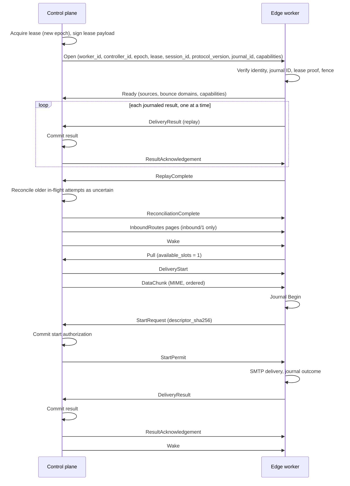

# Control protocol

The control protocol is the only channel between the control plane and the Edge worker. It is one long-lived bidirectional gRPC stream, opened by the control plane. The Edge never initiates a connection to the control plane. Everything the Edge needs (deliveries to send, permission to start SMTP, lease renewals) and everything it reports (results, forwarded bounces, received mail) travels on that stream.

The contract is [`api/control/v1/control.proto`](https://github.com/zyno-io/thinpost/blob/main/api/control/v1/control.proto), package `thinpost.control.v1`. For the components on each side, see [Architecture](/guide/architecture). For certificates, see [Control PKI](/deploy/control-pki).

```proto
service EdgeControl {
  rpc Connect(stream ControlFrame) returns (stream EdgeFrame);
}
```

The current protocol version is 7. Both ends require an exact match: `Open.protocol_version` and `Ready.protocol_version` must both be 7, and a peer on another version is rejected. Plan upgrades that change the version as a coordinated change of both sides.

## Transport and identity

### Mutual TLS

The stream runs over TLS 1.3 with certificates from a private CA. Both sides authenticate.

| Check | Edge (server) | Control plane (client) |
| --- | --- | --- |
| Certificate chain | Client certificate required and verified against the private CA | Server certificate verified against the private CA |
| Name | Not checked | The server certificate must match the configured worker DNS name |
| URI identity | The client certificate must carry exactly one URI SAN that equals one of the configured controller identities | The server certificate must carry exactly one URI SAN that equals the configured worker identity |

Identities are SPIFFE URIs. A valid identity has the scheme `spiffe`, a host, a non-empty path, and no user information, query or fragment. A peer certificate with zero or several matching URI SANs is rejected. Certificate validation is never disabled.

The Edge is configured with at least one controller identity. Individual control-plane process instances are distinguished by `controller_id` (see [Sessions and identifiers](#sessions-and-identifiers)), which the signed lease binds to the certificate identity.

The control plane closes its connection before the verified Edge certificate chain expires, with its clock margin as the buffer. A new connection must pass TLS and identity verification again. The transport provides no live certificate revocation and no credential reload: replacing a certificate takes effect on the next connection.

### gRPC limits

| Limit | Value |
| --- | --- |
| Maximum gRPC message, each direction | 128 KiB |
| Maximum data in one `DataChunk` | 64 KiB |
| Concurrent streams on the Edge listener | 2 |
| Concurrent sessions on the Edge | 2. A further `Connect` is answered `RESOURCE_EXHAUSTED`. |
| Edge write to the stream | 15 seconds. A write that blocks longer ends the session with `DEADLINE_EXCEEDED`. |

## Sessions and identifiers

One `Connect` call is one session. A new session always acquires a new epoch, even when the same controller reconnects.

| Identifier | Format | Meaning |
| --- | --- | --- |
| `worker_id` | 1 to 128 characters of `A-Z a-z 0-9 - _` | The Edge worker this lease is for. Must equal the worker's configured ID. |
| `controller_id` | Same format | One control-plane process instance. Must be unique per process. |
| `epoch` | Positive integer | Allocated by the control plane's database for every session. Monotonic per worker. |
| `session_id` | 32 lowercase hex characters | Generated by the control plane for each session. |
| `journal_id` | 32 lowercase hex characters | Identity of the Edge's attempt journal, created on first use and persisted. |
| `attempt_id`, `delivery_id` | Same format as `worker_id` | Opaque tokens. Never contain addresses or message content. |

## Session lifecycle



In order:

1. **Lease.** The control plane acquires a lease for the worker in its database. This allocates the epoch and an expiry. It signs the lease with its mTLS private key. If another controller holds an unexpired lease for the worker, acquisition fails and the control plane retries later.
2. **Open.** The control plane opens the stream and sends `Open` as its first frame. The Edge checks the verified peer identity, then that `worker_id` equals its own, `controller_id` is present, `epoch` is nonzero, `session_id` is 32 lowercase hex, `protocol_version` is 7, `capabilities` is well formed, and `journal_id` equals its journal's identity. It then verifies the lease proof and persists the fence (controller ID and epoch). Any failure ends the stream with a gRPC error ([Errors](#errors)).
3. **Ready.** The Edge answers `Ready`, echoing worker, journal, epoch, session and protocol version, and reporting its source addresses, SMTP host names, bounce domains and capabilities. The control plane checks the echoed values and validates the reported lists.
4. **Replay.** The Edge sends each unacknowledged result from its journal as a `DeliveryResult`, one at a time, and waits for the exact `ResultAcknowledgement` before sending the next. If the journal holds an attempt still in flight, the session ends with `FAILED_PRECONDITION` (`unreconciled journal attempt`). The Edge marks attempts left in flight by a restart as uncertain when it starts, so this occurs only for an inconsistent journal. After the last acknowledgement the Edge sends `ReplayComplete`.
5. **Reconciliation.** On `ReplayComplete`, the control plane marks every older in-flight database attempt for the worker (an epoch below the current one) as uncertain and holds it, in batches of 128 under the current lease, until none remain. It then sends `ReconciliationComplete`. The Edge does not accept `Wake` or forward bounces and inbound mail until it receives a `ReconciliationComplete` that matches the worker, journal, session and epoch.
6. **Steady state.** The control plane sends `Wake`; the Edge answers with `Pull` when its journal has capacity; deliveries follow one at a time. Lease renewals, bounces, inbound mail and SMTP submissions interleave.
7. **End.** Either side can end the stream. Any stream or lease failure on the control plane ends the session, and the control plane's process reconnects ([Reconnection](#reconnection)).

### Lease renewal

The control plane renews every one third of the lease TTL (20 seconds for the 60-second default). It sends a `LeaseRenewal` carrying a freshly signed payload for the same epoch, and the Edge answers `LeaseAccepted` with the epoch and the SHA-256 of the payload. The control plane adopts the new expiry only after it receives a matching `LeaseAccepted`. If the next renewal timer fires before the previous renewal was acknowledged, the session ends.

## Message reference

Every control-plane frame is a `ControlFrame` with one `body`; every Edge frame is an `EdgeFrame`.

| `ControlFrame` body | Field | Purpose |
| --- | --- | --- |
| `Open` | 1 | Starts the session and carries the lease |
| `Wake` | 2 | Hint that work may be available |
| `DeliveryStart` (`delivery`) | 3 | Describes one delivery |
| `DataChunk` (`mime_chunk`) | 4 | MIME bytes of the delivery |
| `ResultAcknowledgement` (`result_ack`) | 5 | Confirms a result was committed |
| `BounceAcknowledgement` (`bounce_ack`) | 6 | Confirms a forwarded bounce |
| `LeaseRenewal` (`lease_renewal`) | 7 | Extends the lease |
| `StartPermit` (`start_permit`) | 8 | Authorizes the Edge to start SMTP |
| `ReconciliationComplete` (`reconciliation_complete`) | 9 | Ends reconciliation |
| `InboundRoutes` (`routes`) | 10 | Routing snapshot page (`inbound/1`) |
| `InboundAcknowledgement` (`inbound_ack`) | 11 | Verdict for an inbound message (`inbound/1`) |
| `SubmissionAuthResult` (`auth_result`) | 12 | Answer to a credential check (`submission/1`) |
| `SubmissionAcknowledgement` (`submission_ack`) | 13 | Verdict for an SMTP submission (`submission/1`) |

| `EdgeFrame` body | Field | Purpose |
| --- | --- | --- |
| `Ready` | 1 | Accepts the session |
| `Pull` | 2 | Requests one delivery |
| `DeliveryResult` (`result`) | 3 | Reports an SMTP outcome |
| `BounceStart` (`bounce`) | 4 | Begins a forwarded bounce |
| `DataChunk` (`bounce_chunk`) | 5 | Bounce bytes |
| `LeaseAccepted` | 6 | Confirms a lease renewal |
| `ReplayComplete` | 7 | Ends journal replay |
| `StartRequest` (`start_request`) | 8 | Asks permission to start SMTP |
| `InboundStart` (`inbound`) | 9 | Begins a received message (`inbound/1`) |
| `DataChunk` (`inbound_chunk`) | 10 | Received message bytes |
| `SubmissionAuth` (`auth`) | 11 | Asks control to check an SMTP credential (`submission/1`) |
| `SubmissionStart` (`submission`) | 12 | Begins a submitted message (`submission/1`) |
| `DataChunk` (`submission_chunk`) | 13 | Submitted message bytes |

### Open

First frame, control plane to Edge.

| Field | Type | Meaning |
| --- | --- | --- |
| `worker_id` | string | The Edge worker. |
| `controller_id` | string | The control-plane process instance. |
| `epoch` | uint64 | The database-allocated epoch for this session. |
| `lease_payload` | bytes | The signed lease JSON, at most 2,048 bytes. |
| `lease_signature` | bytes | Signature over the payload, at most 1,024 bytes. |
| `session_id` | string | 32 lowercase hex characters. |
| `protocol_version` | uint32 | `7`. |
| `journal_id` | string | The Edge journal identity the control plane expects. |
| `capabilities` | repeated string | Optional features the control plane supports. `inbound/1` and `submission/1` are the defined values. |

A capability list holds at most 8 entries of at most 32 characters from `a-z 0-9 / - _ .`. Unknown capabilities are ignored.

### Ready

| Field | Type | Meaning |
| --- | --- | --- |
| `worker_id`, `epoch`, `session_id`, `protocol_version`, `journal_id` | | Echo `Open`. The control plane rejects any mismatch. |
| `source_addresses` | repeated string | The addresses the Edge can send from, primary first. Absent for a legacy Edge. |
| `bounce_domains` | repeated string | Domains the Edge accepts bounces for. |
| `capabilities` | repeated string | Optional features the Edge supports (`inbound/1`, `submission/1`). |
| `source_hostnames` | repeated string | The SMTP name each source address greets with, one per `source_addresses` entry in the same order. |
| `submission_ports` | repeated uint32 | Public ports on which the Edge currently accepts SMTP AUTH (465 and 587). Observed availability only; never used to tell clients where to connect. Meaningful only with `submission/1`. |

The control plane validates the lists and treats a violation as an invalid readiness:

- `source_addresses`: at most 16 entries, each unique, in canonical text form, and a public address.
- `source_hostnames`: absent, or exactly one normalized, unique DNS name per source address, each at most 219 characters.
- `bounce_domains`: at most 24 entries, normalized and unique, each at most 219 characters.
- `submission_ports`: at most 8 entries, each unique and from 1 to 65535. It is checked only when the Edge reported `submission/1` and the control plane serves it, and a violation then is an invalid readiness; otherwise the field is ignored. The Edge refuses to enable submission with an invalid list. The control plane records the ports for display only when it serves `submission/1` itself and the Edge reported the capability; otherwise it records none.
- No sources with bounce domains or host names is malformed. No sources and no domains means a legacy Edge, which sends only from its primary address.

The control plane never hands the Edge a delivery whose source or bounce domain the Edge did not report. Such a delivery stays queued.

### Lease messages

`LeaseRenewal`:

| Field | Type | Meaning |
| --- | --- | --- |
| `lease_payload` | bytes | New signed lease JSON for the same worker, controller, journal and epoch. |
| `lease_signature` | bytes | Signature over the payload. |

`LeaseAccepted`:

| Field | Type | Meaning |
| --- | --- | --- |
| `epoch` | uint64 | The epoch of the session. |
| `payload_sha256` | bytes | SHA-256 of the accepted `lease_payload`. |

### Wake and Pull

`Wake` is empty. It is a hint and not a queue item; the Edge may ignore it. `Pull` asks for work:

| Field | Type | Meaning |
| --- | --- | --- |
| `available_slots` | uint32 | Must be `1`. The Edge handles one delivery at a time per session. |

The Edge answers `Wake` with `Pull` only after reconciliation, when it is not already waiting for a delivery or executing one, has no unacknowledged result, and its journal has capacity. At most one `Pull` is outstanding. While the control plane has no work for a pull it keeps the pull pending and checks again every poll interval (3 seconds by default).

### DeliveryStart

Sent after a `Pull`. The MIME bytes follow as `DataChunk` frames.

| Field | Type | Meaning |
| --- | --- | --- |
| `attempt_id` | string | The attempt. The `DataChunk.id` of the MIME chunks. |
| `delivery_id` | string | The delivery (one recipient). |
| `epoch` | uint64 | Must equal the session epoch. |
| `mx_name` | string | The mail exchanger name used for TLS server name checks. |
| `destination_ip` | string | The numeric address to connect to. The control plane resolves the MX and applies destination policy. The Edge dials this address as given and does not filter it. |
| `envelope_from` | string | The SMTP return path. |
| `recipient` | string | The SMTP recipient. |
| `enhanced_protection` | bool | When true, the Edge requires TLS for the SMTP connection. |
| `expected_size` | uint64 | Size of the MIME in bytes. Must be between 1 and 8 MiB. |
| `sha256` | bytes | SHA-256 of the MIME, 32 bytes. |
| `tracking_send_cutoff_unix_ms` | int64 | Zero for untracked or indefinite signed links. Otherwise a deadline in Unix milliseconds that bounds SMTP time (see [SMTP execution](#smtp-execution)). |
| `source_address` | string | The address to send from. Empty together with `helo_name` means the Edge's primary address and its own host name. |
| `helo_name` | string | The SMTP name to greet with. |

`source_address` and `helo_name` are either both empty or both set. When set, the source must be one the Edge reported and the name a normalized DNS name; otherwise the Edge journals a retryable `REJECTED` outcome with code zero and dials nothing.

The Edge refuses a `DeliveryStart` that arrives before reconciliation, without a pull outstanding, while another delivery is assembling, outside an authorized lease, or with an `epoch` other than the session's.

### DataChunk

Shared by deliveries, bounces and inbound messages.

| Field | Type | Meaning |
| --- | --- | --- |
| `id` | string | The attempt, bounce or inbound ID of the item the chunk belongs to. |
| `offset` | uint64 | Offset of this chunk. Chunks of an item are contiguous and start at zero. |
| `data` | bytes | Between 1 and 65,536 bytes. |
| `last` | bool | True on exactly the chunk that completes `expected_size`. |

The receiver rejects a chunk with the wrong ID, a wrong offset, empty data, data over 64 KiB, data beyond the declared size, or a `last` flag that disagrees with the running total. After the last chunk it checks the SHA-256. Any failure discards the item and ends the session with `INVALID_ARGUMENT`.

### StartRequest and StartPermit

Before the Edge dials, it durably journals the attempt and asks permission:

| Field | Type | Meaning |
| --- | --- | --- |
| `worker_id`, `journal_id`, `session_id`, `attempt_id`, `delivery_id`, `epoch` | | Identify the attempt. |
| `descriptor_sha256` | bytes | SHA-256 of the deterministic protobuf encoding of the complete `DeliveryStart`. |

`StartPermit` wraps the same `StartRequest`:

| Field | Type | Meaning |
| --- | --- | --- |
| `request` | StartRequest | Must equal the pending `StartRequest` exactly. |

The control plane validates the request against the delivery it sent (identity fields, epoch, and that the descriptor hash equals the digest of its own `DeliveryStart`), commits the start authorization in its database under the current lease, and only then sends the permit. The Edge rejects a permit that does not match its pending request. Because the digest covers every field of the descriptor, including `source_address`, `helo_name`, the MIME hash and the tracking cutoff, a permit authorizes exactly one fully specified attempt.

### DeliveryResult and ResultAcknowledgement

`DeliveryResult`:

| Field | Type | Meaning |
| --- | --- | --- |
| `attempt_id`, `delivery_id` | string | Identify the attempt. |
| `epoch` | uint64 | The epoch of the attempt. A replayed result keeps its original epoch. |
| `outcome` | DeliveryOutcome | The outcome. |
| `smtp_code` | uint32 | The SMTP reply code, or `0`. |
| `smtp_stage` | SmtpStage | The command that drew `smtp_code`: `MAIL`, `RCPT` or `DATA`. Unspecified for setup replies. |
| `smtp_enhanced` | string | The RFC 3463 enhanced status code, matching `^[245]\.\d{1,3}\.\d{1,3}$`, parsed from the start of the reply. Reply text is never carried. |

| `DeliveryOutcome` | Meaning |
| --- | --- |
| `ACCEPTED` | The remote server accepted the message. `smtp_code` is 250. |
| `REJECTED` | The remote server did not accept the attempt. `smtp_code` is zero or a 4xx or 5xx code. It does not by itself mean a permanent failure. |
| `UNCERTAIN` | The attempt may have reached the recipient, for example a lost final DATA response. `smtp_code` is zero. |
| `ROUTE_REJECTED` | The endpoint rejected the connection during greeting, EHLO or STARTTLS, before an envelope was presented. 4xx or 5xx code. The control plane can try another route. |
| `RECIPIENT_POLICY_DENIED` | A recipient policy denied the address before any start request. `smtp_code` is zero. The control plane applies the recipient allowlist itself and holds the delivery without involving the Edge. The value is kept so the control plane still handles it from an older Edge, which applied its own copy of the policy. The current Edge never sends it. |

`smtp_stage` and `smtp_enhanced` apply only to a 4xx or 5xx reply. The control plane drops a stage or enhanced code it cannot validate (a stage on a non-error code, an enhanced code that is malformed or whose class digit disagrees with the reply code) rather than failing the result.

The control plane commits each result to its database before it sends `ResultAcknowledgement`:

| Field | Type | Meaning |
| --- | --- | --- |
| `result` | DeliveryResult | The committed result, echoed unchanged. |

The Edge compares every field (attempt, delivery, epoch, outcome, code, stage and enhanced code) with the result it reported. A mismatch ends the session with `FAILED_PRECONDITION`. A matching acknowledgement deletes the entry from the journal.

### Bounce messages

The Edge's public SMTP receiver forwards an inbound bounce to the control plane through the stream and returns SMTP 250 only after a durable acknowledgement.

`BounceStart`:

| Field | Type | Meaning |
| --- | --- | --- |
| `bounce_id` | string | 32 lowercase hex characters. |
| `expected_size` | uint64 | Size in bytes, between 1 and 16 MiB. |
| `recipient_token` | string | The opaque SMTP recipient token, 32 lowercase hex characters. Carried only over the authenticated stream. |
| `sha256` | bytes | SHA-256 of the message, 32 bytes. |

`BounceStart` is followed by ordered `DataChunk` frames with `id` equal to `bounce_id`. The control plane answers:

`BounceAcknowledgement`:

| Field | Type | Meaning |
| --- | --- | --- |
| `bounce_id` | string | The bounce. |
| `durably_accepted` | bool | True only after the control plane committed the message and its receipt. False means the sender should retry. |

The Edge forwards one bounce at a time per session and waits at most 20 seconds. If the wait times out, the stream is lost, or the acknowledgement is negative or arrives when the lease is not valid, the Edge answers the SMTP sender with a temporary failure. It keeps no spool.

### Inbound messages and routes

These frames exist only when both sides advertise `inbound/1`. See [Inbound mail](#inbound-mail-capability) below.

`InboundRoutes`:

| Field | Type | Meaning |
| --- | --- | --- |
| `offset` | uint32 | Number of routes already sent. Zero starts a new snapshot. |
| `last` | bool | True on the page that completes the snapshot. |
| `routes` | repeated InboundRoute | Routes in this page. |

`InboundRoute`:

| Field | Type | Meaning |
| --- | --- | --- |
| `domain` | string | A lowercase DNS name of 3 to 253 characters with labels of at most 63 characters. |
| `group` | uint32 | A nonzero, opaque number standing in for the owning app. Stable only within one snapshot. |
| `state` | InboundRouteState | `ACCEPT` (accept recipients) or `TEMPFAIL` (answer 451 at RCPT). |

`InboundStart`:

| Field | Type | Meaning |
| --- | --- | --- |
| `inbound_id` | string | 32 lowercase hex characters. Also the stored message ID. |
| `expected_size` | uint64 | Size in bytes, from 1 up to a 16 MiB assembler ceiling. |
| `sha256` | bytes | SHA-256 of the message, 32 bytes. |
| `mail_from` | string | The SMTP reverse path, at most 320 bytes. Empty for the null sender. |
| `rcpt_to` | repeated string | Envelope recipients. 1 to 50 entries, each 1 to 320 bytes. |
| `client_ip` | string | The sending client's address. Empty or a valid IP address. |
| `helo` | string | The client's EHLO name, at most 512 bytes. |
| `tls_version`, `tls_cipher` | string | TLS parameters of the SMTP connection, at most 64 and 128 bytes. Empty without TLS. |
| `received_unix_ms` | int64 | Receipt time in Unix milliseconds. |
| `receiver` | string | The Edge's SMTP host name, at most 255 bytes. Used as the authentication-results identifier. |
| `group` | uint32 | The route group the Edge matched. Control ignores it. |

`InboundStart` is followed by ordered `DataChunk` frames on `inbound_chunk` with `id` equal to `inbound_id`.

`InboundAcknowledgement`:

| Field | Type | Meaning |
| --- | --- | --- |
| `inbound_id` | string | The message. |
| `verdict` | InboundVerdict | `ACCEPTED`, `TEMPFAIL` or `REJECTED`. |

### Submission messages

These frames exist only when both sides advertise `submission/1`. See [SMTP submission capability](#smtp-submission-capability) below.

`SubmissionAuth` (Edge to control plane) checks a credential and nothing else:

| Field | Type | Meaning |
| --- | --- | --- |
| `request_id` | string | 32 lowercase hex characters. Echoed in the result. |
| `credential_id` | string | 32 lowercase hex characters (the SMTP username). |
| `secret` | string | `tps_` followed by 43 base64url characters. Never logged. |
| `client_ip` | string | Empty or a valid IP address. |

`SubmissionAuthResult`: `request_id` and `verdict` (`SubmissionAuthVerdict`):

| Verdict | Meaning | Edge SMTP answer |
| --- | --- | --- |
| `OK` | The credential is valid | 235 |
| `INVALID` | Unknown credential or wrong secret (indistinguishable) | 535 5.7.8 |
| `TEMPFAIL` | Database error or draining | 454 4.7.0 |
| `THROTTLED` | The per-session check rate or pending cap was exceeded | 454 4.7.0 |
| `UNAVAILABLE` | The control plane's runtime gate is closed | 421 4.3.2 and close |

The result never reports app state, so a client of a paused app can still authenticate and reach `DATA`, where an exact retry of an accepted message is answered before the pause is considered. An unspecified or unknown verdict is treated as `TEMPFAIL`.

`SubmissionStart`:

| Field | Type | Meaning |
| --- | --- | --- |
| `submission_id` | string | 32 lowercase hex characters. A transfer ID, not the message ID. |
| `expected_size` | uint64 | Decoded message size in bytes, 1 to 7,864,320. |
| `sha256` | bytes | SHA-256 of the message, 32 bytes. |
| `credential_id`, `secret` | string | The credential, checked again by the control plane. |
| `mail_from` | string | The SMTP reverse path: printable ASCII, at most 320 bytes. Empty for the null sender. |
| `rcpt_to` | repeated string | Envelope recipients. 1 to 100 entries, each 1 to 320 bytes. |
| `client_ip` | string | Empty or a valid IP address. |
| `tls_version` | string | TLS version of the SMTP connection as the TLS library names it (`TLS 1.3`), at most 64 bytes. Empty means the message did not arrive over TLS; any non-empty value means it did, and the control plane relies on that for Enhanced Protection. The Edge sets it only from the real connection state. Values not shaped like a TLS or SSL version name are refused. |
| `received_unix_ms` | int64 | Receipt time in Unix milliseconds. |
| `port` | uint32 | `465` or `587`; `0` for the internal listener. |

`SubmissionStart` is followed by ordered `DataChunk` frames on `submission_chunk` with `id` equal to `submission_id`.

`SubmissionAcknowledgement`:

| Field | Type | Meaning |
| --- | --- | --- |
| `submission_id` | string | The transfer. |
| `verdict` | SubmissionVerdict | See the capability section. |
| `message_id` | string | The stored message ID (32 lowercase hex characters). Set only with `ACCEPTED`. |
| `held` | bool | The accepted message is on hold. Set only with `ACCEPTED`. |

## Leases and lease proofs

A lease binds one control-plane process to one worker for a bounded time. It exists in two forms: a row in the control plane's database, which is the authority, and a signed proof the Edge verifies locally.

### Database lease

- Acquiring a lease allocates a new epoch (`epoch + 1`) for the worker and sets an expiry. It succeeds only for the same controller or when the existing lease has expired. Otherwise it fails as held.
- Renewing extends only the exact epoch and controller while the lease is unexpired. It never acquires a lease and never revives an expired or superseded one.
- Delivery claims and start authorizations take a shared lock on the lease row and check expiry under it. A new epoch waits for transactions that hold the old row, so a stale epoch cannot make a new claim or permit.
- When a session ends, the control plane makes a bounded (three-second), best-effort release of its exact lease. A superseding lease is left untouched. Expiry is the fallback.

A lease TTL is between 5 seconds and 5 minutes. The default is 60 seconds. The clock margin must be positive and less than half the TTL (default 5 seconds).

### Signed proof

The control plane signs the lease payload with the private key of its mTLS client certificate. The payload is JSON with these fields, and the Edge rejects unknown fields:

| Field | Type | Meaning |
| --- | --- | --- |
| `worker_id` | string | The worker. |
| `controller_id` | string | The controller process. |
| `journal_id` | string | The Edge journal identity. |
| `identity` | string | The controller's SPIFFE URI identity. |
| `epoch` | uint64 | The epoch. |
| `expires_unix_milli` | int64 | Lease expiry, Unix milliseconds. |

The signed message is the ASCII purpose string `thinpost-controller-lease-v2`, a zero byte, then the payload bytes. Supported keys:

| Key type | Signature |
| --- | --- |
| RSA, 2048 bits or larger | PKCS#1 v1.5 over the SHA-256 of the message |
| ECDSA | ASN.1 signature over the SHA-256 of the message |
| Ed25519 | Ed25519 over the message |

The Edge verifies a proof (in `Open` and in every `LeaseRenewal`) without contacting the control plane:

1. The payload and signature fit their size limits (2,048 and 1,024 bytes) and the payload parses with no unknown fields and no trailing data.
2. The payload's worker, controller, journal and epoch equal the session's, and its `identity` equals the verified mTLS identity.
3. The expiry is in the future by more than the Edge's clock margin and no more than 5 minutes plus the margin ahead.
4. The signature verifies against the public key of the peer's verified leaf certificate.

The Edge grants authority until the earlier of the lease expiry and the expiry of the verified certificate chain, minus the clock margin, measured on a local clock. The Edge's clock margin is configurable, must be positive and at most 30 seconds, and should be at least the real skew between the control plane, its database and the Edge.

When the grant expires the Edge cancels the session and its in-flight SMTP work, even if the peer is idle. A renewal that arrives after the previous grant expired is rejected. A renewal extends the same epoch only.

The Edge trusts any authenticated control-plane process holding a controller identity to sign only leases the database issued. Keep control-plane clocks synchronized and monitor skew.

### Fencing

The Edge stores the current fence (controller ID and epoch) in its journal. A session whose epoch is below the stored epoch, or equal with a different controller ID, is rejected as stale (`FAILED_PRECONDITION`, `controller fence rejected`). Before a new session starts, the Edge cancels the previous one and waits for its SMTP work to stop and journal its results. The fence is checked again immediately before any SMTP start and while a session runs, and a storage failure is treated as loss of authorization.

## Delivery flow

### Assembly and checks

For each delivery the control plane commits the attempt in its database before it sends the MIME. It verifies the MIME size and SHA-256 against the descriptor before sending, then sends `DeliveryStart` and chunks of at most 64 KiB. The Edge assembles the bytes, checks size and digest again, and verifies them once more before SMTP.

### SMTP execution

After assembly the Edge, in order:

1. Journals the attempt (`Begin`). This fails if the journal is full or the attempt or delivery already exists.
2. Refuses a delivery whose tracking cutoff is within 5 minutes.
3. Validates the source address and HELO name.
4. Requests a start permit and waits up to 30 seconds.
5. Dials the destination from the requested source and runs the SMTP transaction. The network time of an attempt is limited to 2 hours, or to the time remaining before the tracking cutoff less 5 minutes when that is shorter. Per-stage SMTP timeouts are configurable on the Edge.
6. Journals the outcome durably, then reports it as a `DeliveryResult`.

If the permit wait expires or is cancelled, the Edge ends the control session before accepting more work: the authorization may already have committed in the control plane, or a permit may arrive late. The Edge records the unsent result in its journal, and the replacement session replays it. A lost final DATA response is reported as `UNCERTAIN`.

If a delivery is interrupted (the session ends, the lease expires, the process restarts), the attempt can be uncertain. Uncertain attempts are held for an operator and are not retried automatically.

### Unpermitted results

After replay, the control plane accepts a `DeliveryResult` only for the delivery it currently has active. If no start authorization was committed for the attempt, the only acceptable results are `REJECTED` or `RECIPIENT_POLICY_DENIED` with `smtp_code` zero. Any other outcome ends the session as `unpermitted SMTP result`.

## Journal and acknowledgements

The Edge keeps a metadata-only attempt journal in a private, regular file (mode `0600`) on a persistent volume. It stores attempt and delivery IDs, epoch, start and finish times, outcome, SMTP code, stage and enhanced code. It never stores recipients, bodies or reply text. It is not a mail queue.

| Property | Behavior |
| --- | --- |
| Identity | A random 32-hex-character `journal_id` created when an empty journal is first opened. An existing non-empty journal without an identity is refused. The control plane must be configured with the same ID, and a mismatch ends the session with `FAILED_PRECONDITION` (`journal identity mismatch`). |
| Capacity | A configured maximum count of unacknowledged attempts. `Pull` is sent only when capacity remains. A full journal refuses `Begin`. |
| Reserve | An optional preallocated file lets outcomes be recorded when the disk is otherwise full. No new attempt is admitted until the reserve is replenished. |
| States | `in_flight`, then one of `accepted`, `rejected`, `route_rejected`, `recipient_policy_denied` or `uncertain`. |
| One attempt per delivery | A delivery can have only one unacknowledged attempt in the journal, uncertain ones included. |
| Recovery | At process start, attempts left `in_flight` become `uncertain`. |
| Faults | A storage error marks the journal unavailable until the process restarts. The Edge stops starting work. |
| Fence | The current controller ID and epoch, monotonic. |

A result is acknowledged only when the control plane has committed it. The Edge deletes a journal entry only on an exact-match acknowledgement, and never an `in_flight` entry. An acknowledgement for an entry the journal no longer has is ignored. Acknowledgements are accepted only while the session's grant and fence are valid; a late acknowledgement is rejected and the result stays in the journal for replay.

A result for an attempt that was permitted must come from the journal recorded with its permit, including a replayed completed result.

A copied or rolled-back journal keeps its `journal_id`. The identity does not detect rollback or fence another worker. Treat the journal volume as durable state: restoring an old copy can lose evidence of attempts that already sent.

## Inbound mail capability

Inbound mail uses the same stream behind the `inbound/1` capability.

**Negotiation.** The control plane lists `inbound/1` in `Open.capabilities` when inbound is configured, and the Edge lists it in `Ready.capabilities` when inbound is enabled. Inbound frames flow only when both sides listed it. The Edge sends inbound frames only after `ReconciliationComplete`. A frame that arrives without the capability negotiated ends the session. Either side can be upgraded first: a peer without the capability ignores the field and the other side sends no inbound frames.

**Routing snapshot.** The control plane builds the snapshot of receiving domains every 10 seconds and sends it, in pages, only when its content changed. It also sends it after reconciliation. Pages are ordered: a page with `offset` zero starts a snapshot, and every later page must continue exactly where the previous one stopped. A page is at most 96 KiB (estimated as the domain length plus 12 bytes per route), a snapshot at most 100,000 routes, and a domain may appear once. A violation ends the session. The Edge swaps the snapshot in atomically on the page with `last` set. While the control plane drains, it sends a final snapshot with every domain in `TEMPFAIL`. Routes whose domain the Edge would refuse are skipped.

**Transfer.** For each message the Edge sends `InboundStart` and chunks, and answers the SMTP client only after the verdict:

| Verdict | Meaning | SMTP answer |
| --- | --- | --- |
| `ACCEPTED` | Durably committed, or an exact duplicate of a committed message | 250 |
| `TEMPFAIL` | Not committed; the sender should retry | 451 |
| `REJECTED` | Permanently refused | 554 |

The control plane sends a verdict only after the database commit and only while its lease is valid. The Edge accepts it only while its own lease and fence are valid. The envelope is untrusted input: the control plane re-resolves every recipient domain and ignores `group`.

Framing and envelope errors are treated differently:

- A bad `inbound_id`, size or SHA-256, or a chunk out of order, is a protocol violation and ends the session.
- An envelope that fails its bounds (recipients, lengths, address) is answered `REJECTED` and the session continues.

At most four messages are in flight per session, and chunks of different messages can interleave. A fifth start is answered `TEMPFAIL` and its chunks are discarded. The control plane gives each message 45 seconds from its start frame to commit. The Edge waits 60 seconds for the verdict and answers 451 if none arrives. A partially received message the Edge abandoned is dropped after 70 seconds. The Edge accepts at most 10 MiB per message and 50 recipients.

The Edge holds routing state and at most four messages in memory. It has no spool. When a session ends it fails every message still in flight, so the SMTP sender gets 451 and retries. See [Inbound mail](/guide/inbound) for the SMTP-side behavior.

Stored message content never travels to the Edge.

## SMTP submission capability

SMTP submission from app clients uses the same stream behind the `submission/1` capability. The Edge terminates SMTP, TLS and AUTH. It never knows which app a credential belongs to and keeps no spool: it forwards the credential with each message and answers 250 only after the control plane's durable acknowledgement.

**Negotiation.** The control plane lists `submission/1` in `Open.capabilities` when it has the SMTP intake, and the Edge lists it in `Ready.capabilities` when its submission listeners are enabled. Submission frames flow only when both sides listed it, and the Edge sends them only after `ReconciliationComplete`. A frame that arrives without the capability negotiated (or before reconciliation) ends the session. Either side can be upgraded first: an Edge without the capability gets no submission frames, and an Edge paired with an older control plane keeps AUTH on its submission ports and answers `454 4.7.0`. The protocol version stays 7.

**Credential check.** The Edge sends `SubmissionAuth` when a client authenticates and waits at most 10 seconds. It has at most 16 checks pending and answers `THROTTLED` itself beyond that. The control plane applies a per-session limit of 20 checks per second with a burst of 40, and the same pending cap, answering `THROTTLED` without a database call. While draining it answers `TEMPFAIL`. It replies only while its lease is valid, and the Edge accepts a result only while its own lease and fence are valid.

**Transfer.** For each message the Edge sends `SubmissionStart` and the decoded message in chunks of at most 64 KiB, and answers the SMTP client only after the verdict. The chunks are sent from the message buffer without copying, and the stream can still be serializing them after the send returns, so the Edge treats the buffer as immutable and never reuses it. Chunks of different messages can interleave.

| Verdict | Meaning | Edge SMTP answer |
| --- | --- | --- |
| `ACCEPTED` | Durably committed, or an exact replay of a committed message | 250 2.0.0 `OK: queued as <id>`, or `OK: held as <id>` when `held` |
| `TEMPFAIL` | Not committed; the client should retry | 451 4.3.0 |
| `RATE_LIMITED` | Sending rate limit | 451 4.4.5 |
| `QUOTA_EXCEEDED` | Sending limit | 452 4.3.1 |
| `BACKLOG` | Too many messages queued | 451 4.3.1 |
| `UNAVAILABLE` | The runtime gate is closed | 421 4.3.2 and close |
| `CREDENTIAL_INVALID` | The credential no longer verifies | 550 5.7.8 |
| `APP_PAUSED` | Fresh submissions only | 550 5.7.1 |
| `FROM_NOT_PERMITTED` | The From policy refused the sender | 550 5.7.1 |
| `MESSAGE_INVALID` | Header syntax or envelope | 554 5.6.0 |
| `TOO_LARGE` | Over the size limit | 552 5.3.4 |
| `RECIPIENT_NOT_PERMITTED` | Refused by the recipient allowlist | 550 5.7.1 |
| `ENCRYPTION_REQUIRED` | Enhanced Protection without TLS | 550 5.7.10 |
| `MISCONFIGURED` | Rewrite target or signing is not ready | 451 4.3.5 |
| `CONTENT_NOT_SUPPORTED` | NUL, bare CR, over-long lines, non-ASCII header bytes | 554 5.6.0 |

The control plane never sends reply text; the Edge maps each verdict to a fixed reply. An unspecified or unknown verdict is `TEMPFAIL`. An `ACCEPTED` acknowledgement without a valid 32-hex `message_id` is also answered 451, and counted: the message may have been committed, but without its ID the client cannot be told which one it is, and its retry is answered from the replay window. The control plane sends a verdict only after the database commit and only while its lease is valid.

Framing and envelope errors are treated differently:

- A bad `submission_id`, size or SHA-256, or a chunk out of order, is a protocol violation and ends the session.
- A malformed credential is answered `CREDENTIAL_INVALID` and an envelope that fails its bounds `MESSAGE_INVALID`; the session continues and the chunks are discarded.

**Limits and memory.** At most 16 messages are in flight per session. The control plane holds a process-wide byte budget of 64 MiB, owned by its session runner rather than by one stream, so it survives reconnects. A message reserves `3 x expected_size + 192 KiB` when its `SubmissionStart` arrives, without waiting: if the budget is spent, or the session is draining, or 16 are in flight, the message is answered `TEMPFAIL` and its chunks are discarded. The reservation is held by the session while the message assembles and passes to the goroutine that commits it, which releases it only when it exits. A goroutine still unwinding after its stream ended therefore keeps its bytes counted, and a message received on the next session can be answered `TEMPFAIL` for that reason. The buffer is allocated only when the first chunk arrives. The Edge holds at most 32 MiB of message bytes in flight: each SMTP connection reserves up to 7.5 MiB from that budget while it reads a message and returns the unused part once the size is known. A small message is copied out of the full-size buffer only when the budget has room for the copy; otherwise the connection keeps its full reservation, so the counted bytes never exceed the budget.

The control plane gives each message 45 seconds from its start frame to commit. The Edge waits 60 seconds for the verdict and answers 451 if none arrives. A partially received message the Edge abandoned is dropped after 70 seconds and remembered as a straggler: the control plane remembers the 64 most recent, ignores their late chunks, and ends the session on a chunk for an item it no longer knows.

**Commit fencing.** The control plane commits a submission under the session's lease (worker, controller and epoch). The commit checks that the lease is still live immediately before it completes, so no submission can commit after a later epoch has been acquired for the worker. Delivery of the acknowledgement is not guaranteed; a lost acknowledgement is covered by the replay window (24 hours with a Message-ID, 10 minutes with only a Date).

| Event | Edge | Client |
| --- | --- | --- |
| Stream lost mid-transfer | Fails the waiting message | 451 |
| Stream lost after commit, before the acknowledgement | Fails the waiting message | 451, then the retry is answered from the replay window |
| Controller takeover | Old session closed, waiters failed | 451 |
| Control plane drains | Credential checks and new starts answered `TEMPFAIL`; in-flight work finishes | 454 or 451 |
| Runtime gate closed | `UNAVAILABLE` | 421 and close |

Stored message content never travels to the Edge.

## Limits

| Limit | Value |
| --- | --- |
| gRPC message size | 128 KiB each direction |
| `DataChunk.data` | 64 KiB |
| Outbound MIME | 8 MiB |
| Forwarded bounce | 16 MiB |
| Inbound message | 10 MiB (assembler ceiling 16 MiB) |
| Inbound messages in flight per session | 4 |
| Inbound recipients per message | 50 |
| Submission message | 7,864,320 bytes decoded |
| Submission recipients per message | 100 |
| Submission messages in flight per session | 16 |
| Submission byte budget | 64 MiB control plane (process-wide), 32 MiB Edge |
| Submission credential checks pending per session | 16 |
| Submission credential check rate (control plane, per session) | 20 per second, burst 40 |
| Submission stragglers remembered per session | 64 |
| Routes in a snapshot | 100,000 |
| Routes page | 96 KiB estimated |
| Source addresses reported | 16 |
| Bounce domains reported | 24 |
| Capabilities per list | 8, each at most 32 characters |
| Lease payload and signature | 2,048 and 1,024 bytes |
| Lease TTL | 5 seconds to 5 minutes (default 60 seconds) |
| Clock margin | Control plane: positive and under half the TTL (default 5 seconds). Edge: positive and at most 30 seconds. |
| Maximum lease expiry ahead of the Edge clock | 5 minutes plus the margin |
| Renewal interval | One third of the TTL |
| Start permit wait | 30 seconds |
| SMTP network time per attempt | 2 hours |
| Tracking cutoff margin | 5 minutes |
| Reconciliation batch | 128 attempts |
| Edge stream write | 15 seconds |
| Bounce forward wait | 20 seconds |
| Inbound commit budget (control) | 45 seconds |
| Inbound verdict wait (Edge) | 60 seconds |
| Abandoned inbound partial | 70 seconds |
| Submission commit budget (control) | 45 seconds |
| Submission verdict wait (Edge) | 60 seconds |
| Credential check wait (Edge) | 10 seconds |
| Abandoned submission partial | 70 seconds |
| Routing snapshot interval | 10 seconds |
| Concurrent sessions per Edge | 2 |

## Errors

An Edge that rejects a session or frame ends the stream with a gRPC status. The control plane treats any stream error as the end of the session.

| Code | Message | Cause |
| --- | --- | --- |
| `RESOURCE_EXHAUSTED` | `edge session capacity reached` | The Edge already has its maximum sessions. |
| `UNAUTHENTICATED` | `verified TLS identity required` | No verified peer certificate, or its URI identity is not an allowed controller. |
| `PERMISSION_DENIED` | `invalid controller session` | The first frame is not a valid `Open` (wrong worker, missing controller ID, zero epoch, bad session ID, protocol version other than 7, malformed capabilities). |
| `FAILED_PRECONDITION` | `journal identity mismatch` | `Open.journal_id` does not equal the Edge journal's identity. |
| `PERMISSION_DENIED` | `controller lease unavailable` | The lease proof is invalid, expired, mismatched or not signed by the peer. |
| `FAILED_PRECONDITION` | `controller fence rejected` | A stale epoch, or the same epoch from another controller. |
| `PERMISSION_DENIED` | `controller lease expired` | The grant expired or the persisted fence is no longer current. |
| `PERMISSION_DENIED` | `controller lease renewal rejected` or `controller lease renewal arrived too late` | A renewal failed verification, or arrived after the previous grant expired. |
| `FAILED_PRECONDITION` | `unreconciled journal attempt` | The journal holds an attempt still in flight at replay. |
| `INTERNAL` | `journal unavailable`, `invalid journal result` | Journal storage or content error. |
| `INTERNAL` | `delivery execution failed` | The SMTP executor failed, for example a journal write error. |
| `FAILED_PRECONDITION` | `invalid reconciliation acknowledgement` | `ReconciliationComplete` sent twice or with wrong identity. |
| `FAILED_PRECONDITION` | `reconciliation not acknowledged` | `Wake` before reconciliation. |
| `FAILED_PRECONDITION` | `delivery not authorized` | A delivery or chunk outside the pull and assembly sequence, or with a wrong epoch. |
| `INVALID_ARGUMENT` | `invalid delivery`, `invalid delivery chunk` | Bad descriptor, or a chunk or digest check failed. |
| `FAILED_PRECONDITION` | `result acknowledgement mismatch`, `invalid result acknowledgement` | An acknowledgement that does not match the pending result. |
| `FAILED_PRECONDITION` | `invalid SMTP start permit`, `start request not authorized` | A permit that does not match the pending request, or a start request outside an execution. |
| `FAILED_PRECONDITION` | `inbound routes not negotiated`, `inbound acknowledgement not negotiated` | Inbound frames without the negotiated capability. |
| `FAILED_PRECONDITION` | `submission not negotiated` | A credential result or submission acknowledgement without the negotiated capability. |
| `INVALID_ARGUMENT` | `invalid inbound routes`, `empty control frame` | A malformed routing page, or an empty frame. |
| `INVALID_ARGUMENT` | `invalid submission frame` | A credential result or acknowledgement frame with no content. |
| `UNIMPLEMENTED` | `control frame not implemented` | A frame the Edge does not accept. |
| `DEADLINE_EXCEEDED` | `control stream write timed out` | The Edge could not write to the stream within 15 seconds. |

The control plane ends its own session, without a status, when the Edge violates the sequence: a repeated or mismatched `Ready`, a result or pull out of order, a `StartRequest` that does not match the active delivery or its descriptor digest, an unexpected bounce or chunk, an invalid chunk, or a `LeaseAccepted` that does not match the pending renewal. For submission it also ends the session on `submission not available` (a submission frame without the negotiated capability or before reconciliation, a malformed `request_id`, bad start framing, or a duplicate or over-numerous transfer), `invalid chunk`, `invalid final chunk` and `digest mismatch` (the assembler's errors for a chunk out of order, a bad length or final flag, or a wrong SHA-256), `invalid submission chunk` and `invalid final submission chunk` (the same checks on a discarded transfer), `unexpected submission chunk` (a chunk for an unknown transfer) and `submission straggler overflow` (a chunk for a transfer that aged out of the straggler memory). It also ends the session when its own lease expires (`controller lease expired`) or when a database commit fails.

## Reconnection

Any failure ends the session and cancels its in-flight work. The control plane then reconnects and runs the whole lifecycle again.

- The control process retries after 5 seconds, indefinitely. A lease held by another controller is expected while a previous process drains, and is not logged.
- Each reconnect acquires a new epoch and generates a new `session_id`. It replays and reconciles before any new work is requested.
- Interrupted attempts are not lost: the Edge replays journaled results, and the control plane marks unresolved older attempts uncertain.
- On a planned shutdown the control process stops pulling work, lets a claimed delivery and its result finish, keeps renewing its lease, and tells the Edge to answer 451 for inbound domains. It allows 12 seconds from the shutdown signal, then cancels the stream. Normal replay and uncertain handling apply to anything interrupted. Make sure the platform's termination grace period is longer than this.
- Releasing a lease does not prove SMTP has stopped. A replacement must still drain and reconcile the worker before the sending address moves to a different worker.

## Related

- [Architecture](/guide/architecture)
- [Control PKI](/deploy/control-pki)
- [Key and certificate rotation](/operations/rotation)
- [Recovery and the admission gate](/operations/recovery)
- [Inbound mail](/guide/inbound)
