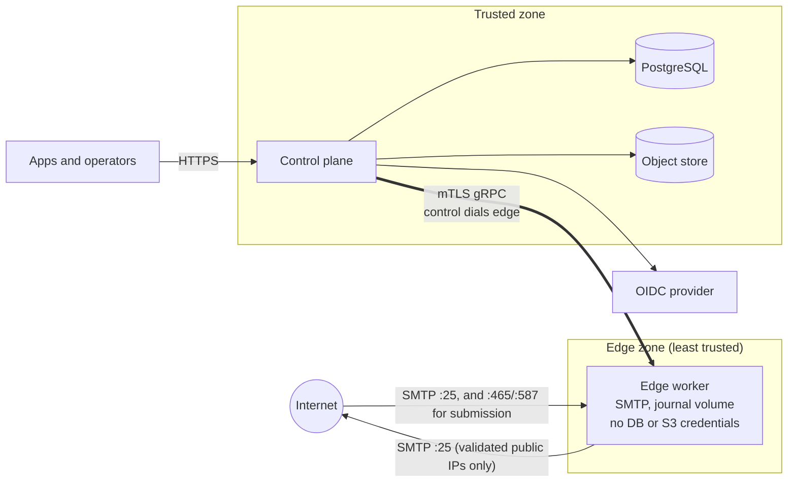

# Threat model

Thinpost splits mail handling into a **trusted zone** that holds all state and makes every decision, and an **edge zone** that exposes SMTP to the internet and holds almost nothing. The design assumes the edge is the most exposed component and limits what an attacker who controls it can do.

This page summarizes the intended properties. It is not an audit or a guarantee. Thinpost is pre-1.0, so review these properties against your own risk before you rely on them. To report a weakness, see [Reporting vulnerabilities](/security/reporting).

## Trust boundaries



| Zone | Holds | Exposed to |
| --- | --- | --- |
| Trusted | PostgreSQL, the object store, encryption keys, DKIM keys, API-key digests, webhook secrets, the operator console | Apps and operators over HTTPS, and nothing else from the internet |
| Edge | The SMTP listeners, one sending identity per public IP, and a metadata-only journal | The public internet on port 25 (and on ports 465 and 587 when [SMTP submission](/guide/smtp) is enabled), and a private control connection from the trusted zone |

### What the edge cannot do

- **It has no database or object-store credentials.** An attacker on the edge cannot read stored messages, API keys or app data, and cannot write to the database.
- **It receives only what it needs.** It gets the bytes of a delivery it was asked to send, one at a time, and keeps no message bodies. Its journal records attempt metadata, not content.
- **It never connects into the trusted zone.** The control plane dials the edge, and the edge never opens a connection into the trusted zone. It holds no address or credential for the database or object store.
- **It cannot decide to send.** Before any SMTP connection it must ask for a start permit, and the control plane commits the authorization in the database first.
- **It cannot accept inbound mail or bounces on its own.** The edge answers `250` to a bounce or inbound message only after the control plane has stored and committed it, and answers `451` otherwise.
- **Accepting bounces at any domain adds no power.** The edge takes a `b+<token>` recipient at any domain whose DNS points at it, not only its own names. That changes nothing about what a compromised edge can do: it still cannot acknowledge a bounce without the control plane's commit, and the control plane still refuses unknown tokens. Anyone could already connect to the edge and send to its own names.
- **A customer's bounce domain is customer-controlled DNS, and the decision to use it is control's.** A customer can break or repoint their own record at any time, and the result is an automatic fall back to the HELO name: control uses a custom Return-Path only when the delivery is claimed, from current state, and only if the domain is active, was checked within 3 hours, still resolves to the HELO name of the IP that delivery leaves from, is not a receiving domain (the two kinds are kept apart under an advisory lock, and the claim rechecks) and is not one of the worker's own names. Any edge can advertise `bounce-any-domain/1` and choose which name it reports for which IP, so it can influence which domain control picks, but control makes the choice and checks it against current state at claim time, and an edge already controls the envelope sender (MAIL FROM) of everything it sends, so this gives it nothing new. An edge that does not advertise the capability gets the HELO name. DNS spoofing of control's resolver (there is no DNSSEC validation) could at worst activate a misaligned Return-Path: mail is still delivered and DKIM carries DMARC. A domain must sit under a verified sender domain, whose DKIM record proves the customer controls it, so one app cannot point another customer's names at its IP. The check only reads DNS; it never connects to the customer's name.
- **A customer's tracking domain is customer-controlled DNS, and the decision to use it is control's.** Tracking links are not bound to a hostname, so any host that routes to the deployment serves any link, and a custom domain adds no new access to a link. What the check proves is "an HTTPS request to this name, with a normal certificate check, reaches this deployment": control fetches `https://<name>/t/h/v1/<random challenge>`, connects only to public addresses, follows no redirects, uses no proxy and reads at most 512 bytes, then verifies an HMAC under a key derived from the tracking seeds. Any host that reverse-proxies `/t/h/` to the deployment passes the check. That is by design, because the proof means "this deployment", and only an admin-added domain under the app's verified sender domain (whose DKIM record proves the customer controls it) is ever used for links, and only while its check is fresh (3 hours). The DNS result is informational and never gates use, so a proxied name works and DNS spoofing at control's resolver gains nothing. The console never answers on a customer's name because custom domains need `THINPOST_ADMIN_ORIGIN`, and the console and API return an empty 404 on every other hostname. A customer who points a name at the deployment can open tracking links at it (they already can at the tracking host); an operator route is still needed for TLS. One-click unsubscribe links always stay on the deployment's own origin.
- **It cannot accept submitted mail on its own.** With SMTP submission on, the edge answers `250` only after the control plane has verified the credential, applied the app's policy and limits and committed the message. It cannot verify a credential itself: it relays the control plane's verdict.
- **It runs as non-root.** The process refuses to start as root.

The edge can see the mail it is delivering and the mail it receives, and with SMTP submission on, the credentials and message content of every client that connects, while they are in transit. Compromise of the edge exposes those, so treat the edge zone as sensitive and keep its network policy tight. [Enhanced Protection](/guide/concepts) requires TLS for the SMTP hop but cannot protect content from the process that delivers it.

### SMTP submission credentials

Clients send an SMTP credential's username and password to the edge, inside TLS, and the edge hands them to the control plane to check. This is the one place where a secret that grants sending rights passes through the edge zone, so the edge's compromise has a defined and limited effect.

An attacker who controls the edge **can**:

- read the credentials and message content of every client that connects while they are in control, because TLS ends at the edge;
- submit mail as any credential they have seen, within that app's policy: its From policy and verified domains, the recipient allowlist, suppressions, rate and quota limits, and its pause state;
- deny or delay submission.

They **cannot**:

- learn credential digests, app IDs or the replay secret, which stay in the trusted zone;
- mint a credential or guess one: the control plane checks every attempt against its digest, and the secrets are 256-bit random values;
- use a stolen SMTP credential on the HTTP APIs, or an API key for SMTP;
- make the console or API tell people to connect to a host that public DNS does not map to an address the edge reported: the SMTP submission host and the inbound MX host come from the edge's report, and control shows them only after checking public DNS in both directions: the reported address's reverse DNS must name the host, and the host's A records must include the address. Lookups fail closed (NXDOMAIN, SERVFAIL, timeout or mismatch hide the name). Reverse DNS is set by whoever runs the address block, not by the edge, so a compromised edge cannot get a domain it owns shown and later point it elsewhere;
- make a careful client skip TLS, as long as the certificate keys are uncompromised. The edge does hold the private keys of its public SMTP certificates (and of the internal listener's certificate) and enforces TLS-before-AUTH itself, so with those keys an attacker can impersonate the server to any client, and a client that does not require TLS or does not verify the certificate can be tricked into sending credentials in clear text.

One residual risk: the feedback mailbox address (`b+<token>@<main HELO name>`) is shown to administrators only and is not DNS-checked, so a compromised edge could report a different name for its main IP and change the address administrators register with mailbox providers. After any edge compromise, rotate the feedback mailbox as well.

If you suspect the edge was compromised, revoke and reissue every SMTP credential. See [the runbook](/operations/rotation#smtp-credentials-and-an-edge-compromise).

## The control protocol

The control protocol is mutual TLS gRPC from the control plane to the edge.

- **Identities.** A private CA issues separate certificates, with URI identities, to the control plane and the edge. Each side checks the peer's chain and identity. No service mesh is required. See [Control PKI](/deploy/control-pki).
- **Leases.** A control replica holds a short database-issued lease with an epoch. The control plane signs it with its mTLS key, and the edge verifies it against the authenticated peer certificate and its own journal identity. A new stream gets a fresh epoch, which fences earlier controllers. The edge limits every grant to the earlier of the lease expiry and the controller certificate chain's validity, and cancels in-flight work when the grant ends.
- **Start permits.** A permit binds the worker, journal, session, epoch, attempt and a hash of the complete delivery descriptor. The edge rejects a permit that does not match.
- **Expiry.** Each side closes its session before the verified peer chain expires.
- **Journal.** The edge journals every attempt before the SMTP connection. After a failure, unfinished attempts are held as uncertain rather than resent, which trades possible delay for no duplicate mail.

The protocol gives no live revocation and does not reload the trust roots without a restart. Rotate and monitor certificates as described in [Rotation](/operations/rotation).

## Outbound SMTP egress policy

The control plane is the sole authority for the recipient allowlist and the egress policy. It applies both before it authorizes a delivery, and the edge executes what control authorizes: it does not re-check the recipient allowlist or the destination. A compromised control plane could therefore have the edge deliver to any recipient and connect to any numeric address on port 25 that its network allows. The boundary against that is the network around the edge, which must be a firewall or NetworkPolicy that allows only outbound TCP 25 to public destinations (see [Direct public networking](/deploy/direct-public-networking)). Treat those controls as required, not optional.

What control enforces when it resolves a recipient's route:

- **Numeric public addresses only.** Control resolves the MX name and hands the edge a validated IP. The edge dials that IP on port 25, keeps the MX name for TLS validation, and binds the connection to a source address it owns. A bind failure fails the dial. The kernel never substitutes another source.
- **Special-use ranges are denied.** Private, loopback, link-local, carrier-grade NAT, documentation, benchmarking, multicast and reserved ranges are refused, and IPv6 destinations are never routed: sending addresses are IPv4.
- **Your own infrastructure is denied.** You supply infrastructure ranges, including public addresses you own. Destinations inside them are refused. Control also checks every source address the edge reports when its session starts: a source outside the ranges, or one that a route exception names, ends the session as an invalid readiness. Control never routes mail to an address the edge reports as a source, primary or additional. This stops mail being relayed into your own network or back to the edge.
- **Exceptions are exact.** An operator-supplied exception allows one recipient, one MX host name and one public IP together. Special-use addresses and every source address stay denied even when listed.
- **Sources are the edge's reported IPv4 addresses.** The edge must report public IPv4 sources inside your infrastructure ranges, or its session is refused.

The edge itself only checks that a requested source is one of its own addresses of the destination's family. DNS answers are not DNSSEC-validated, so the MX data is unauthenticated, and a recipient policy or allowlist is the control for restricting recipients.

## Applications and keys

- Apps are security principals. Each has its own API keys, sender domains, quotas and webhooks, and an app cannot read another app's data.
- API-key secrets appear only in the creation response. The database stores a digest. An app key is never accepted as an operator identity.
- An administrator can pause an app. A pause stops new submissions and new send authorizations, but a permit already issued or a webhook already in flight can still complete.
- Optional per-app submission rate limits and tracking event budgets limit what a compromised key can do.

## Webhook destinations

Webhook destinations are a server-side request forgery surface, so they are restricted. Endpoints must be HTTPS on port 443, use DNS names, and resolve only to public unicast addresses, which Thinpost checks at connection time on every attempt. The resolved address is pinned for the connection and TLS verifies the original name. Redirects are not followed and no proxy is used. An operator can allow named in-cluster destinations explicitly. See [Webhooks](/guide/webhooks).

## Operator console and API

### OIDC token validation

The operator API accepts only a verified administrator identity and fails closed if its authenticator is not configured. The verifier requires:

- a JWT access token (an ID token or an app API key does not qualify) with an allowed signature algorithm: `RS256` by default, optionally `ES256`, `EdDSA` or `PS256`;
- an exact `iss` match and an `aud` that contains the configured API audience, which must differ from the browser client ID;
- `exp` and `iat` claims, a subject, and 30 seconds of clock leeway;
- a signature that verifies against a key from the configured HTTPS JWKS endpoint. JWKS redirects are refused, the request times out after five seconds, and keys refresh every five minutes;
- the configured administrator role in the configured role claim, and, unless role-only mode is explicitly chosen, the configured scope. Even in role-only mode a non-empty `scope` or `scp` claim is required.

In role-only mode, a client-credentials token from a provider that puts scopes on such tokens can carry the role. Do not assign the administrator role to a service account. Details are in [Operator authentication](/deploy/operator-auth).

**Test sends.** An administrator can submit a message as an app from the console (`POST /api/v1/apps/{appId}/messages/test`). By default the request is policy-bound: it takes the app's acceptance path, so sender-domain verification, recipient rules, suppressions, the submission rate, the recipient quota and the pending-message limit all apply, and a paused app refuses it. The profile is narrow (verified From, one to five To recipients, no attachments, custom headers, tracking choices or hold) and the body is limited to 64 KiB. It uses no API key. It is audited as `message.test.submitted` in the same transaction as the message, and the message is tagged as a console test in every message read. It still delivers real mail, and its webhooks fire, so treat the administrator role as one that can send as any app.

Two operator-only options relax part of that path, only on this route. The app API and every provider route reject them with 400, even when false, and the acceptance and commit layers refuse them for any principal that is not an administrator on the console adapter.

- **Skip sending limits** skips, and does not count, the submission rate, the daily recipient quota and the pending-message limit. The rate bucket and the quota are untouched, and the message is left out of the app's pending count. An administrator can already change those limits, so this adds no new capability.
- **Skip recipient allowlist** skips the deployment's recipient allowlist, at acceptance and at the control plane's dispatch recheck. It exists to check delivery to an address outside a staging allowlist. It requires a confirmation in the console, and the audit event and the message tag record it. It does not skip the egress policy.

Neither option skips the verified sender domain, DKIM signing, suppressions, a paused app, the admission gate, any size or profile limit, the egress policy, or Enhanced Protection TLS. The audit event for a test send carries only the recipient count and the two flags.

Reads of message history are not audited. Content reads of Enhanced Protection messages are audited before data is returned. See [Data handling](/security/data-handling).

### Console content security

The console is served from the same origin as the API with:

```text
Content-Security-Policy: default-src 'none'; script-src 'self'; style-src 'self' 'unsafe-inline';
  img-src 'self' data: blob:; font-src 'self'; connect-src 'self' <issuer origin>;
  frame-src 'none'; child-src 'none'; worker-src 'none'; object-src 'none';
  base-uri 'none'; form-action 'none'; frame-ancestors 'self'; manifest-src 'self'
```

- No `unsafe-eval` and no `https:` in `img-src`, so remote images and external CSS in rendered email are blocked.
- Stored email HTML renders only in a sandboxed, opaque-origin iframe with a sanitized `srcdoc` and its own restrictive policy. It never enters the console DOM.
- Attachments download as `application/octet-stream` with `nosniff`, a sandboxing CSP and `Content-Disposition: attachment`, whatever type was submitted.
- The operator API sends `default-src 'none'; frame-ancestors 'none'; sandbox`, `nosniff` and `Referrer-Policy: no-referrer` on every response.
- The signed-in user is kept in `localStorage` so that sessions survive reloads. The console never stores refresh tokens, key secrets, message content, addresses or search terms in the browser.

The issuer's origin is the only external connection allowed. Extra origins for a provider with token endpoints on another host are added with `THINPOST_CONSOLE_CONNECT_ORIGINS`, as bare HTTPS origins only.

## Stored data

- Objects (original submissions, signed MIME, bounces and inbound messages) are encrypted by the control plane with AES-256-GCM before upload. The object key is bound into the ciphertext, so an object copied to another key fails to decrypt.
- The database holds plaintext metadata that the console needs: recipients, sender domains and addresses, and subjects, including Enhanced Protection subjects. Treat the database, its backups and its WAL as sensitive. See [Data handling](/security/data-handling).
- Webhook signing secrets are sealed with the object keyring and never returned.
- DKIM private keys are generated in the control plane, sealed with the object keyring (the associated data binds each to its row, so a copy moved to another row will not open) and never returned or logged. A retired key's private half is deleted from the database; copies in old row versions or backups stay sealed and need the keyring to open. A copy of the database alone cannot sign mail; the database together with the keyring can. Before DKIM keys moved into the database, compromising the Secret that held the key files was enough.
- SMTP credentials are stored as SHA-256 digests, with the password shown once at creation. Mail sent over SMTP is stored as the client's original message in the object store, encrypted like any other submission.
- Retry protection for SMTP mail stores keyed digests only (an HMAC of the app, sender, recipients, `Message-ID` and message bytes), so database content cannot confirm a guess about what was sent. The digests expire after 24 hours or 10 minutes, depending on what the message carries. The key is permanent: it is sealed once under the object keyring and never re-sealed. See [Data handling](/security/data-handling#smtp-submission).

## Out of scope

Thinpost does not protect against:

- an attacker with direct write access to the database or the object store;
- a compromised control plane, which holds the keys;
- an operator who holds the administrator role;
- failures of your identity provider, DNS or certificate authority;
- the content of mail once it reaches the recipient's server. Required TLS covers the SMTP hop only.
